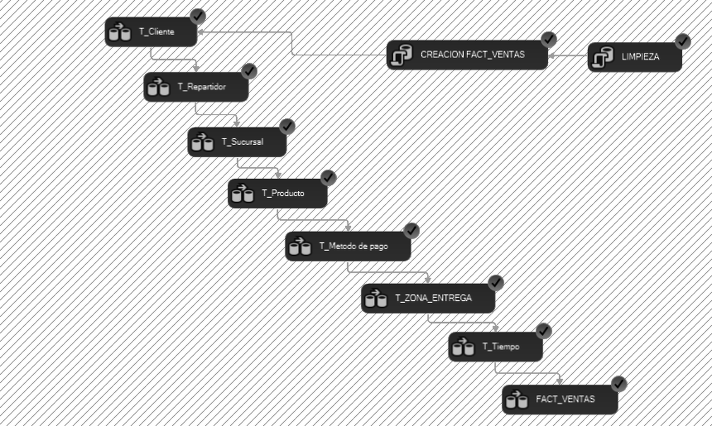
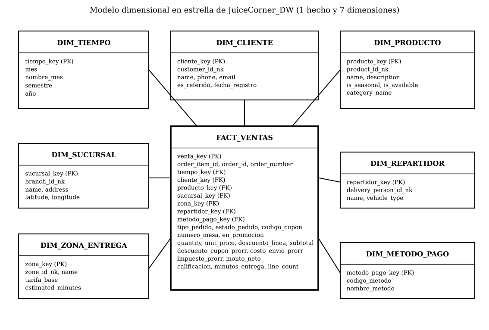
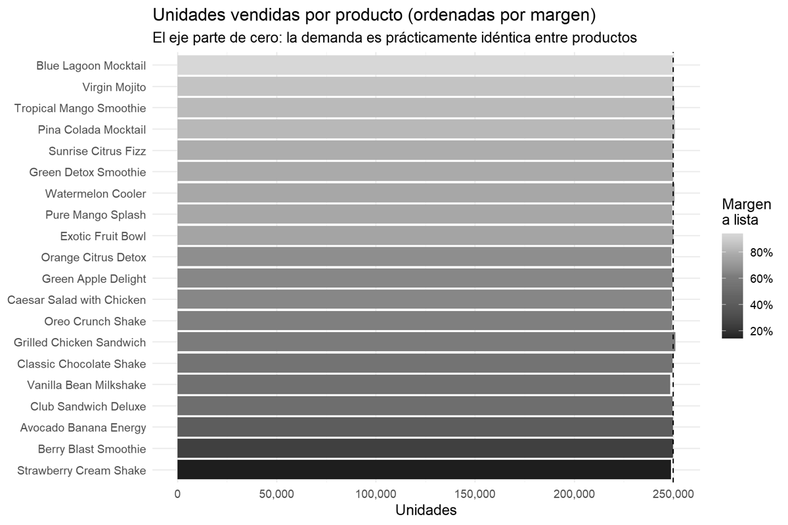
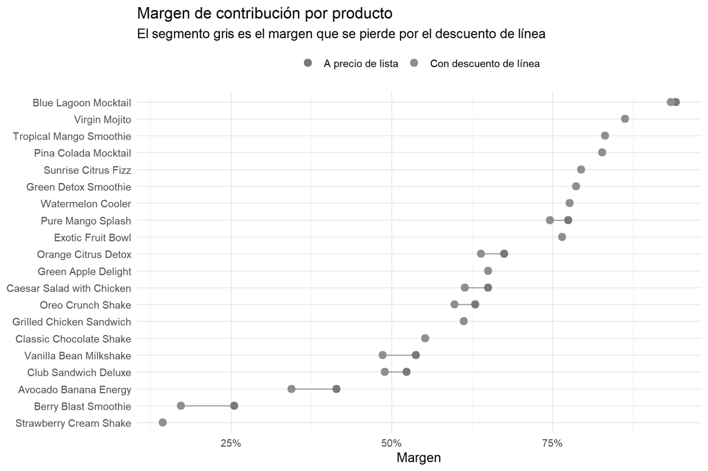
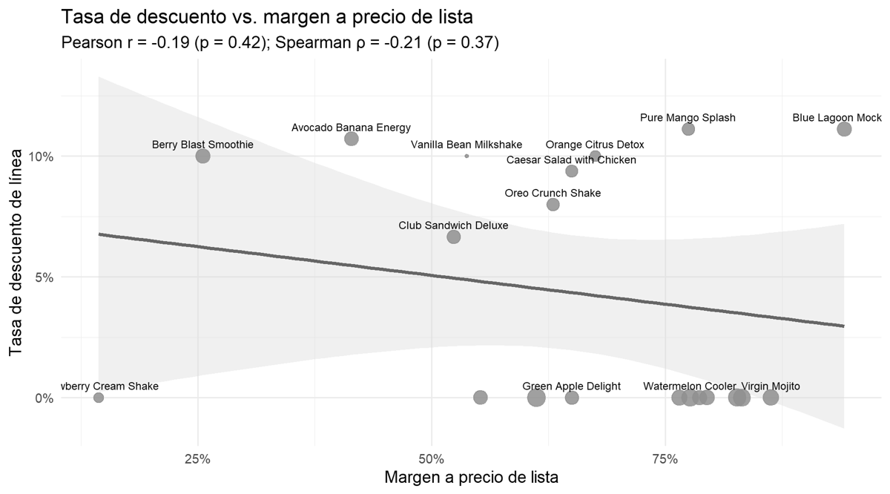
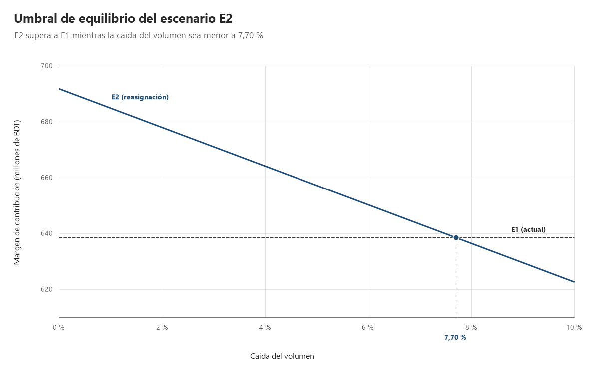

# CAPÍTULO I: MARCO INTRODUCTORIO

## TÍTULO DEL PROYECTO

**Diseño de una Política de Descuentos Alineada con la Rentabilidad por Producto, Mediante Análisis y Simulación de Escenarios, en Juice Corner BD de la Ciudad de Dhaka, Bangladesh**

---

## 1. PLANTEAMIENTO DEL PROBLEMA

### 1.1 Contextualización Empresarial

Juice Corner BD es una cadena comercial del sector gastronómico especializada en la elaboración y venta de jugos naturales, batidos y snacks, con tres sucursales operativas situadas en Dhaka, Bangladesh. La empresa comercializa un menú de 20 productos a través de dos canales principales: consumo en salón (*dine_in*) y servicio a domicilio (*delivery*), registrando sus transacciones en moneda local, el Taka bangladesí (BDT).

La base transaccional de estudio comprende **162 días continuos de operación comercial** (del 11 de enero al 21 de junio de 2026, ~5,5 meses / semestre base S0) sobre el dataset original sin modificar, abarcando un universo de 1.000.000 de órdenes de compra, 2.498.660 líneas de detalle transaccional y 4.995.377 unidades físicas comercializadas.

### 1.2 Diagnóstico de la Situación Problemática

La rentabilidad operativa de Juice Corner BD se encuentra severamente erosionada debido a la aplicación de una política de descuentos empírica, dispersa y desprovista de criterios económicos de margen de contribución. Actualmente, la organización destina el **7,24 % de su subtotal neto a descuentos**, lo que representa 78.843.704 BDT: 52,38 millones correspondientes a descuentos directos de línea y 26,47 millones a cupones promocionales.

El análisis cuantitativo de los registros históricos pone de manifiesto cuatro distorsiones fundamentales:

1. **Desalineación Crítica entre Descuento y Margen por Producto:**
   No existe una relación positiva entre el descuento concedido y el margen de ganancia del producto. El producto con mayor margen de contribución de toda la carta (*Blue Lagoon Mocktail*, con un margen unitario de 94,2 %) recibe la tasa de descuento de línea más agresiva de la empresa (11,1 %). Por el contrario, el producto con el margen más reducido (*Strawberry Cream Shake*, con apenas un 14,4 % de margen) no recibe beneficio promocional alguno (0,0 %).
   La correlación de Pearson calculada entre la tasa de descuento otorgada y el margen a precio de lista es negativa y no significativa (*r* = −0,19; *p* = 0,415), lo que descarta que la política histórica premie la rentabilidad. Los productos con descuento registran un margen medio a precio de lista de 60,0 %, frente a 69,1 % en los productos sin descuento.

2. **Aplicación Global y Ciega de Cupones Promocionales:**
   El 38,65 % de las órdenes totales (386.527 órdenes) incluye un cupón de descuento. Estos cupones se deducen a nivel de canasta general sin evaluar la composición de rentabilidad de los artículos adquiridos, restando en promedio **68 BDT de margen neto por pedido**, con una contribución promedio de 615 BDT en órdenes con cupón frente a 653 BDT en órdenes sin cupón.

3. **Inconsistencias y Fuga de Reglas de Negocio en Cupones:**
   Los controles operativos del sistema de ventas evidencian vulnerabilidades críticas de gobernanza: el cupón `EID50` fue redimido fuera de su período de vigencia en el 94,4 % de sus aplicaciones; el cupón `VIP100` se concedió por debajo del importe mínimo de compra requerido en el 18,7 % de las transacciones; y los cinco cupones con límite de usos autorizado lo superaron con creces.

4. **Homogeneidad de Demanda que Invalida la Política Actual:**
   A diferencia de lo que justificaría una estrategia de liquidación o atracción comercial selectiva, el volumen de ventas se distribuye de manera estrictamente plana entre los 20 productos de la empresa: cada uno concentra aproximadamente el 5 % de las ventas totales, oscilando estrechamente entre 248.416 y 250.952 unidades vendidas, con un coeficiente de variación de apenas 0,26 %. Las pruebas de hipótesis inferenciales (ANOVA con *p* = 0,819 y Kruskal-Wallis con *p* = 0,908) confirman que no existen diferencias estadísticamente significativas en la demanda de los productos. Por consiguiente, la asignación diferenciada de descuentos carece de fundamento operativo o de respuesta diferencial de mercado.

#### Tabla 1. Evidencia Cuantitativa de la Línea Base y Desalineación Estructural

| Indicador Clave | Valor Observado (Línea Base S0) | Interpretación Diagnóstica |
| :--- | :--- | :--- |
| **Costo Total de Descuentos s/ Subtotal Neto** | **7,24 %** (78.843.704 BDT) | Absorción desproporcionada del ingreso bruto de ventas |
| **Margen de Contribución Global (Pre-cupón)** | **61,1 %** | Por debajo del umbral corporativo objetivo (≥ 62,0 %) |
| **Margen de Contribución Global (Post-cupón)** | **60,1 %** | Pérdida adicional de 1,0 punto porcentual por promociones globales |
| **Productos con Descuento de Línea** | 9 de 20 productos (tasas: 6,7 % a 11,1 %) | Concentración arbitraria sin criterio de rotación |
| **Descuento en Producto de Mayor Margen** | 11,1 % (*Blue Lagoon Mocktail*, margen: 94,2 %) | Máxima erosión en el artículo más rentable |
| **Descuento en Producto de Menor Margen** | 0,0 % (*Strawberry Cream Shake*, margen: 14,4 %) | Nulo incentivo en productos con alto costo relativo |
| **Participación de Órdenes con Cupón** | **38,65 %** (386.527 órdenes) | Alta penetración promocional sin segmentación de canasta |
| **Pérdida de Margen por Orden con Cupón** | **−68 BDT** por pedido | Reducción de 653 BDT a 615 BDT por transacción |
| **Correlación Descuento vs. Margen (*r*)** | ***r* = −0,19** (*p* = 0,415) | Desalineación estructural: no existe correlación positiva |
| **Pruebas de Variación de Demanda** | ANOVA: *p* = 0,819 \| Kruskal-Wallis: *p* = 0,908 | Demanda homogénea; ningún producto justifica trato preferencial |

*Fuente: Elaboración propia con datos de thesohanur (s. f.). El margen se calcula como (precio de lista − costo de ingredientes) ÷ precio de lista.*

### 1.3 Consecuencias de la Inacción (Pronóstico del Problema)

De mantenerse el esquema actual de descuentos:

- **Concentración de Pérdidas:** Los 7 productos con margen de contribución inferior al 70 % continuarán absorbiendo 42,4 millones de BDT en descuentos, lo que representa el 81 % del gasto en descuentos de línea y el 54 % del costo total de promociones, subsidiando ineficiencias de costo.
- **Sobrecosto Financiero:** La empresa continuará incurriendo en un exceso de gasto promocional de al menos **24,39 millones de BDT anuales** respecto al estándar de mercado y a la meta institucional del 5,00 % del subtotal neto.
- **Estancamiento del Margen Operativo:** El margen de contribución global permanecerá confinado en torno al 60,1 % – 61,1 %, imposibilitando alcanzar la meta financiera mínima del 62,00 % requerida para la sostenibilidad y expansión de las sucursales.

### 1.4 Árbol del Problema

```
                                      EFECTOS / CONSECUENCIAS
 ┌────────────────────────────────────────────────────────────────────────────────────────┐
 │ • Margen global deprimido (61,1 %) por debajo del potencial financiero (meta: ≥62,0 %) │
 │ • Sobrecosto semestral de 24,39 millones de BDT en promociones no justificadas             │
 │ • Reducción directa de 68 BDT de margen por cada orden que aplica cupón                │
 └───────────────────────────────────────────┬────────────────────────────────────────────┘
                                             │
                                     PROBLEMA CENTRAL
 ┌───────────────────────────────────────────┴────────────────────────────────────────────┐
 │  POLÍTICA DE DESCUENTOS Y PROMOCIONES DESALINEADA DE LA RENTABILIDAD POR PRODUCTO      │
 │                     EN LAS SUCURSALES DE JUICE CORNER BD                               │
 └───────────────────────────────────────────┬────────────────────────────────────────────┘
                                             │
                                      CAUSAS RAÍCES
 ┌───────────────────────────────────────────┴────────────────────────────────────────────┐
 │ 1. Asignación arbitraria de descuentos de línea sin ponderación del margen unitario.   │
 │ 2. Cupones promocionales genéricos aplicados a canasta completa sin discriminar mix.   │
 │ 3. Falta de controles de negocio en cupones (fuga de fechas, montos mínimos y cupos).  │
 │ 4. Inexistencia de un modelo analítico de simulación de escenarios de optimización.    │
 └────────────────────────────────────────────────────────────────────────────────────────┘
```

---

## 2. FORMULACIÓN DEL PROBLEMA

### 2.1 Pregunta General de Investigación

> **¿Cómo puede un modelo de análisis y simulación de escenarios reducir la pérdida de margen ocasionada por el otorgamiento de descuentos desalineados con la rentabilidad de los 20 productos de Juice Corner BD, manteniendo constante el volumen de unidades vendidas, los precios de lista y la composición de la carta, durante su próximo año de operación en Dhaka, Bangladesh, a partir del análisis de las 1.000.000 de órdenes del año observado?**

---

## 3. OBJETIVOS DE LA INVESTIGACIÓN

### 3.1 Objetivo General

**Diseñar, mediante un modelo de análisis y simulación de escenarios, una política de descuentos para los 20 productos de Juice Corner BD, basada en el análisis de 1.000.000 de órdenes transaccionales, que permita, en el próximo año de operación de la empresa, reducir la proporción de descuentos otorgados del 7,24 % al 5,00 % o menos del subtotal neto y aumentar el margen de contribución global del 61,1 % al 62,0 % o más, manteniendo constante el volumen de unidades vendidas, los precios de lista y la composición de la carta.**

### 3.2 Objetivos Específicos

1. **OE1. Diagnosticar** la estructura histórica de descuentos (de línea y por cupones) y el margen de contribución individual de los 20 productos a partir de 1.000.000 de órdenes de compra.
   - *Entregable:* Tabla consolidada de línea base con indicadores de venta, descuentos y márgenes unitarios.
2. **OE2. Construir** un repositorio dimensional Data Warehouse (esquema estrella con 1 tabla de hechos `FACT_VENTAS` y 7 tablas de dimensiones) que garantice la consolidación, gobernanza e integridad contable de los datos.
   - *Entregable:* Base de datos relacional analítica validada con 0 inconsistencias en la auditoría de cuadre.
3. **OE3. Contrastar** estadísticamente la homogeneidad de la demanda diaria por producto y la correlación existente entre la tasa de descuento otorgada y el margen de ganancia a lista.
   - *Entregable:* Informe de pruebas estadísticas inferenciales (ANOVA, Kruskal-Wallis, Chi-cuadrado, Pearson y Spearman) con niveles de significancia (α = 0,05).
4. **OE4. Estimar** la sensibilidad del comportamiento de la demanda y determinar el umbral de caída de volumen de equilibrio ante variaciones de descuento por canal, sucursal y categoría de producto.
   - *Entregable:* Modelo cuantitativo de elasticidad y matriz de límites de tolerancia de volumen de venta.
5. **OE5. Simular** escenarios de asignación promocional (línea base actual, reasignación moderada y optimización lineal orientada a margen) bajo volumen y carta constantes para el siguiente año operativo.
   - *Entregable:* Matriz comparativa de desempeño financiero y KPIs proyectados por escenario evaluado.
6. **OE6. Proponer** la política definitiva de descuentos diferenciados y la reglamentación estricta de cupones que satisfaga simultáneamente el costo de descuentos ≤ 5,00 % y un margen global ≥ 62,00 %.
   - *Entregable:* Manual de políticas comerciales, reglas de validación de cupones y programa de incentivos alineado al margen.

### 3.3 Matriz de Operacionalización SMART

#### Tabla 2. Matriz de Operacionalización SMART de los Objetivos

| Objetivo | S (Específico) | M (Medible) | A (Alcanzable) | R (Relevante) | T (Temporal) |
| :--- | :--- | :--- | :--- | :--- | :--- |
| **General** | Política integral de descuentos alineada al margen por producto. | Costo de descuento ≤ 5,00 %; margen global ≥ 62,00 %; correlación *r* > 0. | Demanda plana demostrada y volumen constante; ajuste de 0,9 pp de margen. | Corrige la principal causa de fuga de rentabilidad operativa. | Próximo año de operación de la empresa (S1). |
| **OE1** | Diagnóstico de línea base transaccional y rentabilidad. | 1.000.000 órdenes analizadas; 7,24 % costo de descuento; 61,1 % margen. | Datos transaccionales completos disponibles y validados. | Base empírica indispensable de comparación y evaluación. | Año observado (S0). |
| **OE2** | Data Warehouse con esquema dimensional en estrella. | 2.498.660 hechos consolidados; subtotal 1.089.008.540 BDT; 0 descuadres. | Infraestructura SQL Server y procesos ETL optimizados. | Garantiza veracidad y trazabilidad única de la información. | Año observado (S0). |
| **OE3** | Contraste inferencial de demanda y política actual. | Pruebas paramétricas y no paramétricas al 95 % de confianza (α = 0,05). | Scripts automatizados ejecutados en lenguaje R. | Demuestra la arbitrariedad empírica del modelo comercial actual. | Año observado (S0). |
| **OE4** | Modelación de elasticidad y caída de volumen de equilibrio. | Coeficientes de sensibilidad e intervalo de tolerancia de caída de volumen. | Métodos estadísticos y programación matemática formal. | Calibra el riesgo comercial de reducción de descuentos. | Parámetros de S0 proyectados a S1. |
| **OE5** | Simulación de escenarios comerciales proyectados. | Proyección cuantitativa de BDT, porcentaje de descuento y margen en 3 modelos. | Modelo de programación lineal bajo volumen constante. | Permite seleccionar el escenario óptimo con base científica. | Próximo año de operación (S1). |
| **OE6** | Formulación de la política definitiva de descuentos. | Costo final ≤ 5,00 % y margen ≥ 62,00 % demostrados en simulación. | Ahorro anual de hasta 24,39 millones de BDT. | Constituye la solución gerencial definitiva al problema central. | Próximo año de operación (S1). |

*Fuente: Elaboración propia.*

### 3.4 Horizonte Temporal de Evaluación y Metas Comparativas

El desempeño de la política propuesta se evalúa en el marco temporal de la empresa (próximo semestre operativo S1), manteniendo las condiciones fundamentales de mercado del período base observado (S0: 162 días): mismo volumen total de órdenes y unidades, idénticos precios de lista e igual composición de la carta comercial.

#### Tabla 3. Matriz de Metas de Desempeño: Semestre Base Observado (S0) vs. Proyección Semestral (S1)

| Indicador Clave de Rendimiento | S0 Observado (Línea Base Histórica) | S1 Inacción (Política Actual Replicada) | S1 Meta (Política Propuesta) | Criterio de Éxito |
| :--- | :--- | :--- | :--- | :--- |
| **Volumen de Órdenes** | 1.000.000 | 1.000.000 | 1.000.000 | Constante |
| **Unidades Físicas Vendidas** | 4.995.377 | 4.995.377 | 4.995.377 | Constante |
| **Costo de Descuentos (% Subtotal)** | **7,24 %** | **7,24 %** | **≤ 5,00 %** | Reducción ≥ 2,24 pp |
| **Monto de Descuentos (Período)** | 78.843.704 BDT | 78.843.704 BDT | **≤ 54.450.427 BDT** | Ahorro ≥ 24,39M BDT |
| **Margen de Contribución Global** | **61,1 %** | **61,1 %** | **≥ 62,0 %** | Incremento ≥ 0,9 pp |
| **Correlación Descuento vs. Margen** | *r* = −0,19 | *r* = −0,19 | **Positiva (*r* > 0)** | Alineación económica |

*Fuente: Elaboración propia con base en la línea base verificada con los datos (Tabla 12).*

---

## 4. JUSTIFICACIÓN Y DELIMITACIÓN DE LA INVESTIGACIÓN

### 4.1 Justificación Teórica y Metodológica

Desde la perspectiva teórica, la fijación y otorgamiento de descuentos comerciales no debe concebirse como un recurso promocional indiscriminado, sino como una herramienta de optimización microeconómica supeditada al margen de contribución marginal. Metodológicamente, la investigación aporta un marco riguroso de analítica prescriptiva que enlaza la minería de datos transaccionales (Data Warehouse y ETL), la contrastación estadística inferencial y la simulación matemática de escenarios bajo condiciones operativas reales.

### 4.2 Justificación Práctica y Económica

La investigación responde a una necesidad crítica de gestión financiera en Juice Corner BD. La optimización del gasto promocional recupera al menos 24,39 millones de BDT en el año de aplicación sin recurrir a incrementos en los precios de venta al público ni requerir inversiones en infraestructura, fortaleciendo directamente el flujo operativo de la cadena gastronómica.

### 4.3 Delimitación de la Investigación

- **Delimitación Espacial:** Exclusivamente circunscrita a las tres sucursales operativas de la cadena Juice Corner BD en la ciudad de Dhaka, Bangladesh.
- **Delimitación Temporal:** Análisis fundamentado en la base histórica original de **162 días completos de operación regular (S0)**, del 11 de enero al 21 de junio de 2026 (~5,5 meses), con proyección de evaluación para el próximo semestre inmediato de operación (S1).
- **Delimitación Operativa y de Alcance:** La investigación interviene única y estrictamente en las reglas de asignación de descuentos por producto y la gobernanza de cupones. Quedan explícitamente fuera del alcance las variaciones en los precios de lista de la carta, la modificación en recetas de insumos y los cambios en la oferta de productos del menú.

---

## 5. MARCO METODOLÓGICO

### 5.1 Enfoque Metodológico: Cuantitativo

La investigación adopta un enfoque eminentemente **cuantitativo**. Se basa en un razonamiento formal deductivo que parte de los principios económicos de maximización de margen para contrastarlos frente al comportamiento empírico de un registro transaccional masivo de 1.000.000 de órdenes. La recolección y procesamiento se efectúa sobre datos numéricos estructurados, aplicando pruebas estadísticas inferenciales con un nivel de significancia prefijado de α = 0,05.

### 5.2 Diseño de la Investigación: No Experimental y Transversal Analítico

- **No Experimental:** Las variables operativas (precios de venta, costos de insumos, frecuencias de compra y descuentos) se analizan en su condición natural histórica, sin manipulación deliberada sobre el mercado físico. Los efectos de las nuevas directrices se evalúan a través de modelos computacionales de simulación.
- **Transversal Analítico:** Si bien el registro abarca una serie temporal de 162 días, el análisis central se estructura de forma consolidada por producto, canal y sucursal sobre el período base completo, habiéndose verificado la ausencia de tendencias seculares y de efectos por día de la semana.

### 5.3 Tipo y Alcance de la Investigación: Correlacional y Explicativo

- **Alcance Correlacional:** Evalúa el grado de asociación cuantitativa entre el porcentaje de descuento asignado a cada ítem y su respectivo margen de contribución, midiendo la dispersión y el sentido de los coeficientes de Pearson y Spearman.
- **Alcance Explicativo:** Determina las causas estructurales que originan la erosión de beneficios (descuentos desalineados, canibalización por cupones ciegos y demanda homogénea no reactiva) y cuantifica formalmente el impacto marginal que la reestructuración de descuentos ejercerá sobre la rentabilidad global.

### 5.4 Sistema de Hipótesis

#### Hipótesis de Investigación (*H<sub>i</sub>*)

> ***H<sub>i</sub>:*** El diseño y aplicación de una política de descuentos comerciales alineada con el margen de contribución por producto permite reducir el costo total de descuentos al 5,00 % o menos del subtotal neto y elevar el margen de contribución global de Juice Corner BD al 62,00 % o más, manteniendo constantes el volumen de unidades vendidas, los precios de lista y la carta comercial durante el próximo año de operación.

#### Hipótesis Nula (*H<sub>0</sub>*)

> ***H<sub>0</sub>:*** Ninguna política de descuentos comerciales estructurada a partir del margen de contribución permite reducir el costo de descuentos al 5,00 % o menos y elevar simultáneamente el margen global al 62,00 % o más bajo condiciones de volumen y carta constantes.

#### Hipótesis Estadísticas Secundarias

1. **Correlación Descuento – Margen:**
   - *H<sub>0,1</sub>:* ρ = 0 (no existe correlación lineal entre la tasa de descuento de línea y el margen de contribución del producto).
   - *Resultado empírico:* *r* = −0,19 (*p* = 0,415). No se rechaza *H<sub>0</sub>*; se corrobora que la política histórica no premia la rentabilidad.
2. **Homogeneidad de Demanda entre Productos:**
   - *H<sub>0,2</sub>:* μ<sub>1</sub> = μ<sub>2</sub> = … = μ<sub>20</sub> (el volumen diario de unidades vendidas es idéntico entre los 20 productos de la carta).
   - *Resultado empírico:* ANOVA *F* = 0,70, *p* = 0,819; Kruskal-Wallis *H* = 11,45, *p* = 0,908. No se rechaza *H<sub>0</sub>*; la demanda es uniforme y no sustenta descuentos diferenciales por rotación.

### 5.5 Métodos, Técnicas e Instrumentos de Investigación

- **Métodos Teóricos:**
  - *Método Hipotético-Deductivo:* Planteamiento de conjeturas de rentabilidad y contrastación cuantitativa con la evidencia empírica del repositorio analítico.
  - *Método Analítico-Sintético:* Descomposición de la transaccionalidad por niveles (producto, cupón, canal, sucursal) y posterior síntesis en un modelo normativo corporativo.
- **Técnicas y Herramientas Tecnológicas:**
  - *Extracción, Transformación y Carga (ETL):* Procedimientos automatizados en scripts PowerShell (.NET `SqlBulkCopy`) y paquetes SSIS para la ingesta de datos.
  - *Almacenamiento y Modelado Dimensional:* Sistema Gestor de Bases de Datos Microsoft SQL Server, estructurado bajo arquitectura de Data Warehouse dimensional (esquema en estrella).
  - *Análisis Estadístico e Inferencia:* Entorno RStudio / Lenguaje R para la ejecución de tests de normalidad, contrastes de hipótesis (ANOVA, Kruskal-Wallis) y matrices de correlación.
  - *Optimización y Simulación:* Modelos de programación lineal determinista y evaluación estocástica de escenarios de demanda.

### 5.6 Población, Censo y Fuentes de Información

- **Población Objeto de Estudio:** Finita y exhaustiva, constituida por la totalidad del registro transaccional anual: **1.000.000 de órdenes de compra**, **2.498.660 líneas de pedido**, **20 artículos de menú**, **3 sucursales comerciales** y **6 cupones promocionales**.
- **Criterio Muestral:** No se extrae muestra probabilística ni se calcula tamaño muestral; se efectúa un **censo poblacional íntegro (100 % de los registros)** gracias a la capacidad de procesamiento de la arquitectura analítica implementada, eliminando errores de muestreo.
- **Fuentes de Información:**
  - *Fuente Secundaria:* Base de datos transaccional estandarizada de restaurante y delivery, repositorio estructurado verificado e implementado en las bases `JuiceCorner_OLTP` y `JuiceCorner_DW`.

---

# CAPÍTULO II: CONSTRUCCIÓN Y ORGANIZACIÓN DE LOS DATOS

Este capítulo desarrolla el segundo objetivo específico (OE2) y corresponde a la Fase 2 del proyecto: la construcción del repositorio analítico que sustenta el diagnóstico, el contraste estadístico y la simulación de escenarios. Su propósito es garantizar la consolidación, la gobernanza y la integridad contable de los datos transaccionales de Juice Corner BD.

## 2.1 Requerimientos de Información

La base de datos transaccional contiene la información necesaria sobre ventas, descuentos y costos (Tabla 4). Los datos que no están disponibles se cubren mediante supuestos declarados (Tabla 5), de modo que ninguna decisión del modelo dependa de información no documentada.

#### Tabla 4. Información disponible en la base de datos

| Información | Tablas de origen | Uso en el proyecto |
| :--- | :--- | :--- |
| Descuento de línea por producto | `products`, `order_items` | Tasa de descuento por producto |
| Cupones | `coupons`, `orders` | Costo y uso de cupones |
| Costo por producto | `products`, `product_ingredients`, `ingredients` | Margen por producto |
| Ventas | `orders`, `order_items`, `branches` | Unidades, subtotal neto y mezcla |
| Clientes | `customers`, `orders` | Uso de cupón por cliente |

*Fuente: Elaboración propia con base en el esquema transaccional de thesohanur (s. f.).*

#### Tabla 5. Información faltante y supuestos declarados

| Dato faltante | Supuesto | Se usa en |
| :--- | :--- | :--- |
| Respuesta de la demanda al cambiar un descuento | No se supone un valor; se calcula la caída de volumen de equilibrio | Fase 5 |
| Empaque, mano de obra y comisión de delivery | Porcentaje fijo sobre el precio de lista, declarado en el informe | Fase 4 |
| Costos fijos | Valor supuesto y declarado | Fase 4 |

*Fuente: Elaboración propia.*

## 2.2 Identificación de Fuentes de Datos

La única fuente es el sistema transaccional (TPS) de pedidos del restaurante, implementado en Microsoft SQL Server en la base `JuiceCorner_OLTP`, compuesta por 19 tablas (thesohanur, s. f.). El Data Warehouse utiliza 16 de esas tablas (Tabla 6) y excluye `ingredients`, `product_ingredients` e `inventory`, que almacenan las recetas, los costos de los insumos y el stock.

#### Tabla 6. Tablas del TPS utilizadas como fuente

| Tabla del TPS | Tipo | Registros | Destino en el Data Warehouse |
| :--- | :--- | :--- | :--- |
| `orders` | Cabecera del pedido | 1.000.000 | Claves, atributos degenerados e importes prorrateados |
| `order_items` | Detalle del pedido | 2.498.660 | `FACT_VENTAS` (grano de la tabla de hechos) |
| `payments` | Detalle del pedido | 1.000.000 | Método de pago principal |
| `deliveries` | Detalle del pedido | 550.245 | Repartidor y minutos de entrega |
| `reviews` | Transacción relacionada | 748.743 | Calificación de la línea |
| `customers` | Maestro | 5.000 | `DIM_CLIENTE` |
| `customer_addresses` | Maestro relacionado | 6.627 | Puente hacia `DIM_ZONA_ENTREGA` |
| `delivery_zones` | Maestro | 5 | `DIM_ZONA_ENTREGA` |
| `delivery_personnel` | Maestro | 6 | `DIM_REPARTIDOR` |
| `products` | Maestro | 20 | `DIM_PRODUCTO` |
| `categories` | Catálogo | 5 | `DIM_PRODUCTO` (desnormalizado) |
| `branches` | Maestro | 3 | `DIM_SUCURSAL` |
| `dining_tables` | Maestro | 30 | Número de mesa (atributo degenerado) |
| `coupons` | Maestro | 6 | Código de cupón (atributo degenerado) |
| `promotions` y `product_promotions` | Maestro y relación | 5 y 13 | Indicador `en_promocion` |

*Fuente: Elaboración propia con base en el decálogo del Data Warehouse y los archivos de origen de thesohanur (s. f.). Los registros corresponden a los archivos de origen.*

## 2.3 Integración y Limpieza de Datos

Las reglas de integración y limpieza siguen el decálogo técnico del Data Warehouse y se resumen en la Tabla 7.

#### Tabla 7. Reglas de integración y limpieza aplicadas

| Regla | Tratamiento |
| :--- | :--- |
| **Claves** | Cada dimensión tiene una clave sustituta y conserva la clave natural del TPS en una columna única (sufijo `_nk`) para las búsquedas del ETL. |
| **Miembros comodín** | La clave −1 representa al cliente invitado, a la zona "No aplica" (salón o para llevar), al repartidor "No aplica" y al método "Sin pago". Así todas las claves foráneas del hecho son obligatorias. |
| **Datos excluidos** | No se cargan `password_hash`, `loyalty_balance` ni `referral_code` (cliente); `license_number`, `availability` ni la ubicación en tiempo real (repartidor); `price` ni `discounted_price` (producto), porque el precio se toma de `order_items.unit_price`. |
| **Desnormalización** | La tabla `categories` se integra en `DIM_PRODUCTO` para evitar un esquema copo de nieve, y el número de mesa se guarda en el hecho. |
| **Tipos de datos** | Los valores BIT del TPS se convierten a S/N y el método de pago se carga desde el enumerado de 6 valores con un nombre descriptivo. |
| **Prorrateo** | Los importes de la cabecera (cupón, envío e impuesto) se reparten entre las líneas con el peso de línea: subtotal de la línea ÷ suma de subtotales del pedido. |
| **Monto neto** | `monto_neto` = subtotal − descuento por cupón + envío + impuesto. El subtotal de la línea ya está neto del descuento de línea, por lo que no se resta de nuevo. |
| **Pago principal** | Si un pedido tiene varios pagos, se usa el de estado exitoso con mayor monto. |
| **Zona de entrega** | Se obtiene al cargar, con la ruta `address_id` → `zone_id`, y la carga es incremental para no reasignar pedidos antiguos. |
| **Auditoría** | El ETL compara la suma de `monto_neto` de cada pedido con `orders.total_amount` y registra las diferencias en `audit.AUDITORIA_CUADRE_PEDIDOS`. |

*Fuente: Elaboración propia con base en el decálogo del Data Warehouse y el script `JuiceCorner_DW.sql`.*

La fórmula del monto neto coincide con la verificación estadística del Capítulo III: en el 100 % de las órdenes, el total es igual al subtotal menos el cupón, más el envío y el impuesto. Esto confirma que no se debe restar otra vez el descuento del pedido, porque ya equivale a la suma de los descuentos de línea.

El análisis de la fuente también mostró los siguientes casos que el ETL debe manejar. Hay 19 pedidos de delivery sin registro de entrega y 12 entregas todavía en camino, por lo que sus minutos de entrega quedan nulos. Hay 50 pedidos sin pago exitoso (40 pendientes y 10 reembolsados), que van al método "Sin pago". Las 748.743 reseñas están aprobadas y no se repiten por pedido y producto, así que unirlas no multiplica las filas; solo esas líneas tienen calificación y las demás quedan nulas.

## 2.4 Proceso ETL

El proceso se construyó como un paquete de SQL Server Integration Services (`Juice Corner.dtsx`) con dos conexiones: `JuiceCorner_OLTP` como origen y `JuiceCorner_DW` como destino. Como muestra la Figura 1, el flujo de control encadena diez tareas. `LIMPIEZA` elimina la tabla de hechos y vacía las siete dimensiones, y `CREACION FACT_VENTAS` vuelve a crear la tabla de hechos con su clave primaria, su restricción única y sus claves foráneas. Después, siete flujos de datos cargan las dimensiones en este orden: cliente, repartidor, sucursal, producto, método de pago, zona de entrega y tiempo. La dimensión producto se carga con una consulta que une `products` y `categories`; la zona de entrega convierte el indicador de actividad a S/N y evita duplicados; y el tiempo toma los meses distintos de `orders.placed_at`.

El último flujo carga `FACT_VENTAS` con una sola consulta que une cada línea con la cabecera del pedido y busca las claves sustitutas en las dimensiones, asignando −1 cuando no hay cliente, zona, repartidor o pago. La consulta prorratea el cupón, el envío y el impuesto por peso de línea, toma el pago exitoso de mayor monto y la última reseña aprobada, marca si el producto estaba en una promoción vigente y calcula los minutos de entrega. Las dimensiones se cargan antes que el hecho para que las claves sustitutas ya existan al resolver las claves foráneas. La ejecución mostrada se completó con todas las tareas en verde.

#### Figura 1. Flujo de control del paquete ETL en SQL Server Integration Services



*Fuente: Elaboración propia. Captura del paquete `Juice Corner.dtsx` después de una ejecución exitosa, recortada y convertida a escala de grises.*

## 2.5 Diseño del Modelo de Datos

El modelo es un esquema estrella con una única tabla de hechos, `FACT_VENTAS`, y siete dimensiones (Figura 2). El grano del hecho es una fila por línea de pedido, por lo que los pedidos se cuentan con `COUNT(DISTINCT order_id)` y nunca sumando filas. La Tabla 8 describe las dimensiones y la Tabla 9 los campos del hecho.

#### Figura 2. Modelo dimensional en estrella de JuiceCorner_DW



*Fuente: Elaboración propia con base en el script `JuiceCorner_DW.sql`.*

#### Tabla 8. Dimensiones del Data Warehouse

| Dimensión | Origen | Atributos principales | Filas esperadas |
| :--- | :--- | :--- | :--- |
| `DIM_TIEMPO` | `orders.placed_at` (mes) | Clave AAAAMM, mes, nombre del mes, semestre y año | 13 meses |
| `DIM_CLIENTE` | `customers` | Nombre, teléfono, correo, verificaciones, es_referido y fecha de registro | 5.001 |
| `DIM_PRODUCTO` | `products` y `categories` | Nombre, descripción, temporada, disponibilidad y categoría | 20 |
| `DIM_SUCURSAL` | `branches` | Nombre, dirección, teléfono, coordenadas y estado | 3 |
| `DIM_ZONA_ENTREGA` | `delivery_zones` | Nombre, tarifa base, pedido mínimo, minutos estimados y estado | 6 |
| `DIM_REPARTIDOR` | `delivery_personnel` | Nombre, teléfono, tipo y número de vehículo | 7 |
| `DIM_METODO_PAGO` | `payments.method` | Código y nombre del método | 7 |

*Fuente: Elaboración propia. Las filas incluyen el miembro comodín −1 cuando corresponde.*

#### Tabla 9. Campos de FACT_VENTAS por grupo

| Grupo | Campos | Descripción |
| :--- | :--- | :--- |
| Identificadores del TPS | `order_item_id`, `order_id`, `order_number` | Línea y pedido de origen |
| Claves foráneas | `tiempo_key`, `cliente_key`, `producto_key`, `sucursal_key`, `zona_key`, `repartidor_key`, `metodo_pago_key` | Una por dimensión, todas obligatorias |
| Atributos degenerados | `tipo_pedido`, `estado_pedido`, `codigo_cupon`, `numero_mesa`, `en_promocion` | Contexto del pedido |
| Medidas de línea | `quantity`, `unit_price`, `descuento_linea`, `subtotal` | Tomadas del detalle del pedido |
| Medidas prorrateadas | `descuento_pedido_prorr`, `descuento_cupon_prorr`, `costo_envio_prorr`, `impuesto_prorr` | Importes de la cabecera repartidos por peso de línea |
| Medida neta | `monto_neto` | Subtotal − cupón + envío + impuesto |
| Logística y satisfacción | `calificacion`, `minutos_entrega`, `line_count` | Nulos si no hay dato; `line_count` es siempre 1 |

*Fuente: Elaboración propia con base en el script `JuiceCorner_DW.sql`.*

## 2.6 Construcción del Data Warehouse y Controles de Validación

El Data Warehouse se construyó en SQL Server con el script `JuiceCorner_DW.sql`, que crea la base `JuiceCorner_DW` y el esquema `audit` para las tablas de control. Define las siete dimensiones y la tabla de hechos con clave primaria, una restricción única sobre `order_item_id`, restricciones de dominio y siete claves foráneas. Además crea ocho índices analíticos (uno por clave foránea y uno compuesto por pedido, mes y sucursal) y la tabla de auditoría. El script puede ejecutarse más de una vez, porque elimina los objetos previos y solo inserta los datos iniciales cuando no existen: los cuatro miembros comodín, el catálogo de seis métodos de pago y el calendario mensual.

Para verificar la carga, la Tabla 10 compara cada control con el valor esperado de la fuente. Las consultas de verificación se entregan en el archivo `Controles_DW.sql`.

#### Tabla 10. Controles de validación de la carga

| Control | Valor esperado en la fuente | Criterio de aceptación |
| :--- | :--- | :--- |
| Filas de `FACT_VENTAS` | 2.498.660 | Coincide con `order_items` |
| Pedidos distintos (`COUNT DISTINCT order_id`) | 1.000.000 | Coincide con `orders` |
| Suma de subtotal (BDT) | 1.089.008.540 | Coincide con `orders.subtotal` |
| Suma de `monto_neto` (BDT) | 1.147.618.023,60 | Coincide con `orders.total_amount` |
| Pedidos de delivery | 550.264 | Coincide con `orders.order_type` |
| Líneas con calificación | 748.743 | Coincide con `reviews` aprobadas |
| Pedidos con método "Sin pago" | 50 | Coincide con pagos no exitosos |
| Pedidos de delivery sin repartidor | 19 | Clave foránea −1 asignada |
| Filas en `DIM_METODO_PAGO` | 7 | 6 métodos + miembro comodín |
| Miembros comodín (−1) en las dimensiones | 4 | Cliente, zona, repartidor y método |
| Filas en `AUDITORIA_CUADRE_PEDIDOS` | 0 | Sin diferencias de cuadre |

*Fuente: Elaboración propia. Los valores esperados se calcularon con los archivos de origen; la auditoría de cuadre se ejecuta sobre las 1.000.000 de órdenes.*

## 2.7 Limitaciones y Decisiones Pendientes

El decálogo no incluye el costo de los insumos. Las recetas y los costos (`product_ingredients` e `ingredients`) no se cargan al Data Warehouse, así que el margen de contribución, que es el indicador central del proyecto, no se puede calcular solo con él. Corresponde decidir si se agrega una medida de costo por línea al hecho o si el margen se calcula con las tablas del TPS.

El tiempo tiene grano mensual, por lo que el Data Warehouse no permite análisis diarios ni por hora; los análisis por día del Capítulo III usan los datos del TPS. El cupón se guarda solo como código en el hecho, de modo que el monto mínimo, la vigencia y los límites de cada cupón, que se usan para revisar su cumplimiento, no están en el Data Warehouse. Por último, el flujo `T_Tiempo` carga solo los meses que tienen pedidos (13 en la ventana anual), mientras que el decálogo pide incluir todos los meses del rango aunque no registren operaciones; con estos datos todos los meses tienen pedidos, pero conviene confirmar el criterio.

---

# CAPÍTULO III: ANÁLISIS ESTADÍSTICO Y MODELIZACIÓN

Este capítulo desarrolla el tercer objetivo específico (OE3) y corresponde a la Fase 3 del proyecto. Presenta el análisis exploratorio y las pruebas inferenciales que verifican la línea base del Capítulo I y cuantifican la desalineación entre descuentos y margen.

## 3.1 Datos y Método

El análisis se realizó en R sobre las 1.000.000 de órdenes y 2.498.660 líneas de pedido del dataset original de 162 días (del 11 de enero al 21 de junio de 2026; thesohanur, s. f.). Antes de analizar se comprobó que los datos cuadran: las identidades contables de cada orden (subtotal, descuentos y total) se cumplen en el 100 % de los registros y no hay líneas sin orden. Las pruebas usan un nivel de significancia α = 0,05. Como con un millón de órdenes casi cualquier diferencia resulta significativa, cada prueba se acompaña de un tamaño de efecto (V de Cramér, η² o *d* de Cohen) y se interpreta la relevancia práctica, no solo el valor *p*. Los análisis diarios se realizan sobre la serie completa de 160 días completos, excluyendo el primer y el último día por estar incompletos.

La Tabla 11 define los indicadores que se recalculan al cierre de cada fase. El margen global se mide antes de cupones y los cupones se cuentan en el costo de descuentos, para no contarlos dos veces.

#### Tabla 11. Indicadores clave del proyecto

| KPI | Fórmula | Línea base | Meta | Verificación |
| :--- | :--- | :--- | :--- | :--- |
| Costo de descuentos | (Descuentos de línea + descuentos por cupón) ÷ subtotal neto × 100 | 7,24 % | 5 % o menos | Fases 4 y 5 |
| Margen de contribución global | (Ventas netas − costo de ingredientes) ÷ ventas netas × 100, antes de cupones | 61,1 % | 62 % o más | Fases 4 y 5 |
| Alineación descuento–margen | Correlación de Pearson entre la tasa de descuento y el margen a precio de lista de los 20 productos | −0,19 | Positiva (mayor que 0) | Fases 3 y 5 |

*Fuente: Elaboración propia. Subtotal neto: ventas después del descuento de línea.*

## 3.2 Análisis Exploratorio

La Tabla 12 recalcula las cifras de la línea base y confirma los valores del Capítulo I. Los descuentos suman 78,8 millones de BDT: 52,4 millones de descuento de línea y 26,5 millones de cupones.

#### Tabla 12. Línea base verificada con los datos

| Indicador | Valor |
| :--- | :--- |
| Órdenes | 1.000.000 |
| Unidades vendidas | 4.995.377 |
| Ventas netas del descuento de línea (BDT) | 1.089.008.540 |
| Descuento de línea (BDT) | 52.376.310 |
| Descuento por cupón (BDT) | 26.467.394 |
| Costo de descuentos sobre el subtotal neto | 7,24 % |
| Margen de contribución global (antes de cupón) | 61,07 % |
| Margen de contribución global (después de cupón) | 60,10 % |
| Órdenes con cupón | 38,65 % |

*Fuente: Elaboración propia con datos de thesohanur (s. f.). Sobre las ventas a precio de lista (1.141.384.850 BDT), el costo de descuentos es 6,91 %.*

Los 20 productos venden prácticamente lo mismo: entre 248.416 y 250.952 unidades, con un coeficiente de variación de 0,26 % (Figura 3). En cambio, sus márgenes a precio de lista van de 14,4 % a 94,2 % y el descuento de línea reduce el margen de los 9 productos que lo reciben (Figura 4). El ticket medio por orden es 1.089 BDT (mediana de 1.040), con entre 1 y 4 líneas por orden en proporciones iguales (≈ 25 % cada una).

#### Figura 3. Unidades vendidas por producto



*Fuente: Elaboración propia en R con datos de thesohanur (s. f.). Los productos se ordenan por margen a precio de lista; el eje parte de cero.*

#### Figura 4. Margen de contribución por producto, a precio de lista y con descuento de línea



*Fuente: Elaboración propia en R con datos de thesohanur (s. f.).*

## 3.3 Relaciones y Patrones

**Descuentos y margen.** El descuento de línea es un precio rebajado fijo: afecta al 100 % de las líneas de 9 productos durante todo el periodo y equivale a la diferencia entre el precio y el precio con descuento de la tabla de productos. No es una promoción puntual y tampoco coincide con las promociones registradas: 3 productos tienen descuento sin promoción y 6 tienen promoción registrada sin descuento aplicado. La Tabla 13 muestra el descuento por producto.

#### Tabla 13. Descuento de línea por producto

| Producto | Margen a lista | Tasa de descuento | Descuento total (BDT) | Descuento ÷ margen unitario |
| :--- | :--- | :--- | :--- | :--- |
| Blue Lagoon Mocktail | 94,2 % | 11,1 % | 4.996.080 | 12 % |
| Pure Mango Splash | 77,4 % | 11,1 % | 4.987.060 | 14 % |
| Orange Citrus Detox | 67,5 % | 10,0 % | 4.980.260 | 15 % |
| Caesar Salad with Chicken | 65,0 % | 9,4 % | 7.477.950 | 14 % |
| Oreo Crunch Shake | 63,0 % | 8,0 % | 4.987.860 | 13 % |
| Vanilla Bean Milkshake | 53,8 % | 10,0 % | 4.968.320 | 19 % |
| Club Sandwich Deluxe | 52,3 % | 6,7 % | 4.990.840 | 13 % |
| Avocado Banana Energy | 41,4 % | 10,7 % | 7.492.200 | 26 % |
| Berry Blast Smoothie | 25,5 % | 10,0 % | 7.495.740 | 39 % |

*Fuente: Elaboración propia con datos de thesohanur (s. f.). El descuento por unidad se compara con el margen unitario a precio de lista.*

La correlación entre la tasa de descuento y el margen a precio de lista de los 20 productos es negativa pero no significativa (Pearson *r* = −0,19, *p* = 0,415; Spearman ρ = −0,21, *p* = 0,373), como muestra la Figura 5. Con solo 20 productos la prueba tiene poca potencia, por lo que lo correcto es concluir que no existe alineación entre descuento y margen, no que haya una relación inversa demostrada. Los productos con descuento tienen un margen medio a lista de 60,0 %, frente a 69,1 % de los que no tienen. El descuento pesa más donde el margen es menor: en Berry Blast Smoothie consume el 39 % de su margen unitario y en Avocado Banana Energy el 26 %, mientras que en Blue Lagoon Mocktail consume el 12 %.

#### Figura 5. Tasa de descuento y margen a precio de lista por producto



*Fuente: Elaboración propia en R con datos de thesohanur (s. f.). Cada punto es un producto; su tamaño refleja las unidades vendidas.*

Los descuentos aplicados a los 7 productos con margen a lista menor a 70 % suman 42,4 millones de BDT. Eso equivale al 81 % del descuento de línea y al 54 % del costo total de descuentos. Es una cota superior del ahorro posible, porque supone que el volumen no cambia al retirar el descuento.

**Cupones.** Los seis cupones se usan casi igual (unas 64.000 órdenes cada uno) y su uso es independiente de la sucursal (*p* = 0,809) y del tipo de orden (*p* = 0,568). Además, los cupones no cumplen sus propias reglas (Tabla 14): los cinco que tienen límite de usos lo superan por mucho y todos superan su límite por cliente. `EID50`, marcado como inactivo, se usa fuera de vigencia en el 94,4 % de sus órdenes, y `VIP100` se aplica a canastas por debajo de su monto mínimo en el 18,7 %.

#### Tabla 14. Cumplimiento de las reglas de cada cupón

| Cupón | Usos reales | Límite de usos | Fuera de vigencia | Bajo el monto mínimo |
| :--- | :--- | :--- | :--- | :--- |
| WELCOME10 | 64.536 | Sin límite | 0,0 % | 0,0 % |
| JUICE20 | 64.547 | 500 | 13,0 % | 3,9 % |
| EID50 | 64.099 | 200 | 94,4 % | 1,7 % |
| SMOOTHIE15 | 64.781 | 300 | 68,0 % | 0,0 % |
| FREEDEL | 64.460 | 400 | 49,3 % | 6,1 % |
| VIP100 | 64.104 | 100 | 0,0 % | 18,7 % |

*Fuente: Elaboración propia con datos de thesohanur (s. f.). Las órdenes con cupón se comparan con el monto mínimo y la vigencia definidos en la tabla de cupones; el monto mínimo se evalúa sobre el subtotal antes del descuento de línea.*

Las órdenes con cupón tienen un ticket medio de 1.121 BDT frente a 1.069 BDT sin cupón (*d* de Cohen ≈ 0,09). La diferencia es pequeña y se explica en parte porque los cupones exigen un monto mínimo, no porque el cupón haga gastar más. Cada orden con cupón resta en promedio 68 BDT de contribución, de modo que la contribución media por orden es 615 BDT con cupón y 653 BDT sin él. Tampoco hay evidencia de que el cupón cambie la mezcla de productos (V de Cramér = 0,0077). Por último, los 5.000 clientes usan cupón en cerca del 39 % de sus aproximadamente 200 órdenes, con una dispersión igual a la que produciría el azar (0,034 observada y 0,035 esperada), por lo que no hay segmentos de clientes que concentren el uso de cupones.

**Demanda y tiempo.** La mezcla de productos no cambia de forma relevante por sucursal, tipo de orden, mes ni uso de cupón (V de Cramér entre 0,0025 y 0,0077), y las órdenes diarias no muestran tendencia, efecto del día de la semana ni autocorrelación (*p* > 0,05 en todos los casos).

## 3.4 Métodos Estadísticos Aplicados

La Tabla 15 resume las pruebas realizadas, su resultado y la decisión que se toma con cada una.

#### Tabla 15. Resumen de las pruebas estadísticas

| Pregunta | Prueba | Resultado | Decisión |
| :--- | :--- | :--- | :--- |
| ¿Los productos venden lo mismo por día? | ANOVA y Kruskal-Wallis | *F* = 0,70, *p* = 0,819; *H* = 11,45, *p* = 0,908 | No hay diferencias |
| ¿Las unidades totales son uniformes? | χ² de bondad de ajuste | χ²(19) = 31,75, *p* = 0,033; CV = 0,26 % | Diferencia mínima |
| ¿La mezcla cambia por sucursal, tipo de orden, mes o cupón? | χ² de independencia y V de Cramér | V entre 0,0025 y 0,0077 | Asociación despreciable |
| ¿El ticket difiere entre sucursales o tipos de orden? | ANOVA, Kruskal-Wallis y Welch | *p* = 0,267; *p* = 0,235; *p* = 0,069 | No hay diferencias |
| ¿Hay tendencia o estacionalidad diaria? | Regresión, Kruskal-Wallis y Ljung-Box | *p* = 0,307; *p* = 0,641; *p* = 0,275 | No hay patrón |
| ¿El descuento sigue al margen? | Correlación de Pearson y Spearman | *r* = −0,19, *p* = 0,415; ρ = −0,21, *p* = 0,373 | No hay alineación |
| ¿El uso de cupón depende de la sucursal o del tipo de orden? | χ² de independencia | *p* = 0,809; *p* = 0,568 | Es independiente |
| ¿Con cupón se gasta más? | Welch y *d* de Cohen | Diferencia de 52 BDT; *d* ≈ 0,09 | Efecto pequeño |

*Fuente: Elaboración propia en R. Los supuestos del ANOVA se cumplen (Shapiro-Wilk *p* = 0,168; Fligner-Killeen *p* = 0,680).*

## 3.5 Interpretación de Resultados

Los resultados respaldan el problema planteado y precisan dónde actuar. Primero, la demanda es plana y homogénea: no hay un producto, una sucursal ni un tipo de orden que justifique descuentos distintos, así que una sola regla de descuentos sirve para las tres sucursales. Segundo, el descuento no sigue al margen (*r* = −0,19) y más de la mitad del costo total de descuentos (54 %) se concentra en productos con margen a lista menor a 70 %. Tercero, los cupones se reparten al azar, no cumplen sus propias reglas y no muestran un beneficio en ventas ni en mezcla, por lo que hacer cumplir las reglas ya definidas es la palanca más inmediata.

Con esto quedan verificadas las líneas base del Capítulo I (costo de descuentos de 7,24 % y margen de contribución de 61,1 %) y se fija la del tercer KPI: la correlación descuento–margen parte de *r* = −0,19, con meta positiva. Conviene mantener una sola definición de los indicadores: el margen es de 60,1 % si se incluyen los cupones, y el costo de descuentos es de 6,91 % si se mide sobre las ventas a precio de lista.

Las conclusiones tienen límites. Los datos son sintéticos y cubren una ventana anual continua, lo que permite contrastar estacionalidad, pero no sustituye un historial de varios años. La correlación usa 20 productos y tiene poca potencia, y no hay datos para medir cómo reaccionaría la demanda ante un cambio de descuento. Por eso los resultados valen como ejercicio metodológico y la Fase 5 calculará la caída de volumen que anularía cualquier ganancia.

## 3.6 Modelización Empresarial

La modelización convierte los patrones del análisis exploratorio en parámetros y usa esos parámetros para simular políticas de descuento. Se estimó un modelo log-lineal de demanda por mínimos cuadrados ordinarios (MCO), con errores estándar robustos a la heterocedasticidad, y con él se construyeron tres escenarios: la mezcla actual (E1), una reasignación moderada (E2) y la mezcla optimizada que se resolverá por programación lineal en la Fase 5 (E3).

### 3.6.1 Especificación del modelo y datos

<p style="text-align:center; font-style:italic; margin:12pt 0;">ln(Q<sub>it</sub>) = β<sub>0</sub> + β<sub>1</sub>·ln(P<sub>it</sub>) + β<sub>2</sub>·D<sub>it</sub> + β<sub>3</sub>·Desc<sub>it</sub> + δ<sub>1</sub>·Delivery<sub>it</sub> + γ<sub>2</sub>·Gulshan<sub>it</sub> + γ<sub>3</sub>·Banani<sub>it</sub> + u<sub>it</sub></p>

Cada variable se define así:

- Q<sub>it</sub>: unidades vendidas del producto *i* en el día *t*, en la sucursal y el canal correspondientes.
- P<sub>it</sub>: precio efectivo medio por unidad, es decir, el precio de lista menos el descuento de línea aplicado.
- D<sub>it</sub>: tasa media de descuento de línea, en puntos porcentuales.
- Desc<sub>it</sub>: intensidad del cupón de la orden, medida como porcentaje del subtotal.
- Delivery<sub>it</sub>: variable dicótoma (1 = domicilio, 0 = salón).
- Gulshan<sub>it</sub> y Banani<sub>it</sub>: dicótomas de sucursal, con Dhanmondi como referencia.
- u<sub>it</sub>: término de error.

La forma logarítmica en precio y cantidad hace que β<sub>1</sub> se lea directamente como elasticidad; las variables en niveles se interpretan como cambios porcentuales aproximados en la cantidad ante un punto porcentual adicional. La estimación sigue el tratamiento clásico del modelo lineal general y de la corrección de White para varianzas no constantes (Gujarati y Porter, 2010).

El panel tiene 19.440 observaciones y combina 20 productos, 3 sucursales y 2 canales en los 162 días de operación que registra la base transaccional, del 11 de enero al 21 de junio de 2026. Cada celda agrega las unidades del día, el precio efectivo medio, la tasa media de descuento y la intensidad media del cupón. Los escenarios se evalúan sobre el volumen anual del Capítulo I, porque la elasticidad es adimensional y se aplica a esa base sin necesidad de reestimar el modelo.

### 3.6.2 Estimación y bondad de ajuste

La Tabla 16 presenta los coeficientes con errores estándar robustos HC1, necesarios porque la prueba de Breusch-Pagan rechaza la homocedasticidad (apartado 3.6.3).

#### Tabla 16. Modelo MCO de demanda (variable dependiente: logaritmo de las unidades)

| Variable | Coeficiente | Error estándar (HC1) | z | p | Significancia |
| :--- | :--- | :--- | :--- | :--- | :--- |
| Constante (β<sub>0</sub>) | 5,9523 | 0,057 | 104,70 | < 0,001 | *** |
| ln(P) — elasticidad precio (β<sub>1</sub>) | −0,0792 | 0,009 | −8,63 | < 0,001 | *** |
| Descuento de línea (β<sub>2</sub>) | 0,0006 | 0,0002 | 2,74 | 0,006 | ** |
| Intensidad del cupón (β<sub>3</sub>) | −0,0113 | 0,001 | −10,18 | < 0,001 | *** |
| Delivery (δ<sub>1</sub>) | 0,2009 | 0,002 | 105,70 | < 0,001 | *** |
| Gulshan (γ<sub>2</sub>) | −0,0023 | 0,002 | −0,99 | 0,323 | n.s. |
| Banani (γ<sub>3</sub>) | −0,0028 | 0,002 | −1,21 | 0,227 | n.s. |

*Fuente: Elaboración propia en Python con statsmodels. MCO con errores robustos HC1; n = 19.440; R² = 0,369; F = 1.896 (p < 0,001). *** p < 0,001; ** p < 0,01; n.s. no significativo.*

El modelo es globalmente significativo y explica el 36,9 % de la variación del logaritmo de las unidades. El ajuste es moderado, como corresponde a un panel agregado sin efectos fijos por producto: el interés no está en predecir cada celda, sino en estimar la dirección y la magnitud de los efectos, y en ese plano los cuatro regresores centrales son significativos.

### 3.6.3 Validación de los supuestos

#### Tabla 17. Diagnóstico de los supuestos clásicos del MCO

| Supuesto | Prueba | Estadístico | p | Decisión |
| :--- | :--- | :--- | :--- | :--- |
| Normalidad de los residuos | Jarque-Bera | 710.187,8 | < 0,001 | Se rechaza; la inferencia se sostiene por el teorema central del límite (n = 19.440) |
| Homocedasticidad | Breusch-Pagan | — | 0,014 | Hay heterocedasticidad; se usan errores robustos HC1 |
| Autocorrelación | Durbin-Watson | 1,174 | — | Autocorrelación positiva, propia del panel; cubierta por HC1 |
| Multicolinealidad | Factor de inflación de varianza | Máximo 2,73 | — | Sin problema: todos los VIF son menores que 5 |

*Fuente: Elaboración propia en Python con statsmodels.*

La normalidad se rechaza, como era previsible con 19.440 observaciones y una distribución de ventas con cola a la derecha (asimetría −3,66; curtosis 31,69); el tamaño de la muestra permite apoyarse en la normalidad asintótica. La heterocedasticidad se corrige con HC1 y los coeficientes conservan su significancia: el descuento de línea pasa de p = 0,004 a p = 0,006 y el resto no cambia de decisión. La autocorrelación positiva es esperable en un panel con persistencia diaria y también queda cubierta por la matriz robusta. La multicolinealidad no representa un problema, porque el VIF máximo es 2,73.

### 3.6.4 Interpretación económica

**Precio.** El coeficiente β<sub>1</sub> = −0,0792 (p < 0,001) indica que un aumento de 1 % en el precio reduce la cantidad en 0,08 %. La demanda es inelástica (|β<sub>1</sub>| muy inferior a 1): el cliente de Juice Corner no ajusta su compra al precio, de modo que retirar descuentos no destruye volumen de forma apreciable.

**Descuento de línea.** El coeficiente β<sub>2</sub> = +0,0006 (p = 0,006) indica que un punto porcentual adicional de descuento eleva la cantidad en 0,06 %. El efecto es significativo desde el punto de vista estadístico, pero nulo desde el económico: el descuento de línea subsidia compras que habrían ocurrido igual.

**Cupones.** El coeficiente β<sub>3</sub> = −0,0113 (p < 0,001) indica que un punto más de intensidad del cupón reduce la cantidad en 1,1 %. El signo negativo confirma que los cupones no generan demanda nueva: capturan órdenes que ya iban a comprarse, en línea con los 68 BDT de margen que resta cada orden con cupón.

**Canal.** El coeficiente δ<sub>1</sub> = +0,2009 (p < 0,001) indica que el domicilio vende 22,3 % más unidades que el salón (e<sup>0,2009</sup> − 1). Si se conserva algún incentivo, debe concentrarse en ese canal.

**Sucursales.** Los coeficientes γ<sub>2</sub> = −0,0023 (p = 0,323) y γ<sub>3</sub> = −0,0028 (p = 0,227) no son significativos. Las tres sucursales se comportan igual, lo que confirma el resultado descriptivo y descarta promociones diferenciadas por local.

### 3.6.5 Escenarios de política

El escenario E2 aplica una regla simple sobre el margen unitario a precio de lista: retira el descuento de los productos con margen menor a 50 %, lo reduce a la cuarta parte entre 50 % y 70 %, y a la mitad por encima de 70 %. Además, baja la penetración de cupones de 38,65 % a 20 % de las órdenes, que es el nivel que el propio diseño de los cupones sugiere. La Tabla 18 compara los tres escenarios.

#### Tabla 18. Comparación de escenarios de política de descuentos

| Indicador | E1 — mezcla actual | E2 — reasignación moderada | E3 — optimización (Fase 5) |
| :--- | :--- | :--- | :--- |
| Volumen (unidades) | 4.995.377 | 4.995.377 | 4.995.377 |
| Descuento de línea (BDT) | 52.376.310 | 11.842.878 | Por resolver |
| Descuento por cupón (BDT) | 26.467.394 | 13.695.935 | Por resolver |
| Descuento total (BDT) | 78.843.704 | 25.538.812 | ≤ 54.450.427 |
| Costo de descuentos (% de ventas netas) | 7,24 % | 2,26 % | ≤ 5,00 % |
| Margen antes de cupón (BDT) | 665.035.834 | 705.569.266 | — |
| Margen antes de cupón (%) | 61,07 % | 62,47 % | ≥ 62,00 % |
| Margen después de cupón (BDT) | 638.568.440 | 691.873.331 | — |
| Margen después de cupón (%) | 58,64 % | 61,25 % | — |
| Ahorro frente a E1 (BDT) | — | 53.304.892 | — |

*Fuente: Elaboración propia. El costo de descuentos se calcula sobre las ventas netas del descuento de línea de cada escenario; sobre precio de lista, E1 equivale a 6,91 % y E2 a 2,24 %.*

Con esa regla, el costo de descuentos cae de 7,24 % a 2,26 % y el margen después de cupón sube de 58,64 % a 61,25 %. El ahorro es 53,30 millones de BDT, muy superior al mínimo de 24,39 millones que exige la meta de 5 % (78,84 − 54,45 millones), porque E2 retira descuentos completos en lugar de recortarlos hasta el límite.

Conviene separar las dos metas del Capítulo I. El KPI de margen se define antes de cupones: con esa definición, E1 parte de 61,07 % y E2 llega a 62,47 %, de modo que E2 ya cumple el objetivo de 62 % y también el de 5 % de costo. La cifra de 61,25 % de la tabla es la misma realidad medida después de restar el cupón, y es la que se compara con el 58,64 % de E1. E3 no repite ese ejercicio: es el programa lineal que maximiza el margen sujeto a volumen constante, costo de descuentos de 5 % o menos y límites de demanda por producto, y se resolverá en la Fase 5. La meta de 64 % que plantearon las orientaciones de la asignatura exige, además de recortar descuentos, reasignar la mezcla de volumen.

### 3.6.6 Análisis de sensibilidad

La ventaja de E2 no depende de que el volumen se mantenga exacto. La Tabla 19 y la Figura 6 muestran que E2 sigue por encima de E1 mientras la caída del volumen no supere 7,70 %, equivalente a 384.644 unidades.

#### Tabla 19. Sensibilidad del margen de E2 a la caída del volumen

| Caída del volumen | Volumen (unidades) | Margen E2 (BDT) | Margen E1 (BDT) | Diferencia (BDT) | Mejor escenario |
| :--- | :--- | :--- | :--- | :--- | :--- |
| 0 % | 4.995.377 | 691.873.332 | 638.568.440 | +53.304.892 | E2 |
| 1 % | 4.945.423 | 684.954.598 | 638.568.440 | +46.386.158 | E2 |
| 3 % | 4.845.516 | 671.117.132 | 638.568.440 | +32.548.692 | E2 |
| 5 % | 4.745.608 | 657.279.665 | 638.568.440 | +18.711.225 | E2 |
| 7 % | 4.645.701 | 643.442.198 | 638.568.440 | +4.873.758 | E2 |
| 7,70 % | 4.610.733 | 638.568.440 | 638.568.440 | 0 | Equilibrio |
| 10 % | 4.495.839 | 622.685.998 | 638.568.440 | −15.882.442 | E1 |

*Fuente: Elaboración propia. El margen de E2 se reduce en la misma proporción que el volumen; E1 se mantiene como referencia.*

#### Figura 6. Umbral de equilibrio del escenario E2



*Fuente: Elaboración propia con los parámetros del modelo MCO y los totales de la Tabla 18.*

Con la elasticidad estimada, retirar los descuentos eleva el precio efectivo medio 3,72 %, lo que reduce la cantidad en 0,3 % (0,0792 × 3,72 %). El umbral de 7,70 % es unas veinticinco veces esa caída, de modo que el riesgo de que E2 deje de ser superior a E1 es muy bajo.

### 3.6.7 Contraste con las orientaciones de la asignatura

Las cinco orientaciones de Modelización Empresarial I se contrastaron con los resultados. La Tabla 20 resume el resultado de cada una.

#### Tabla 20. Contraste de las orientaciones de la asignatura con los resultados

| Orientación | Resultado del modelo | Estado |
| :--- | :--- | :--- |
| Si la elasticidad es baja en productos de alto margen, se pueden recortar descuentos sin perder volumen | β<sub>1</sub> = −0,0792 (p < 0,001). Blue Lagoon, con 94,2 % de margen, recibe el mayor descuento (11,1 %); retirarlo reduciría sus ventas cerca de 1 %. | Confirmado |
| Si delivery es significativo, diseñar promociones solo para ese canal | δ<sub>1</sub> = +0,2009 (p < 0,001): el domicilio vende 22,3 % más unidades que el salón. | Confirmado |
| Si alguna sucursal es significativa, diferenciar promociones por local | γ<sub>2</sub> y γ<sub>3</sub> no significativas (p = 0,323 y p = 0,227). | No aplica |
| Usar los parámetros estimados para simular escenarios con volumen constante | E1, E2 y E3 construidos; E2 libera 53,30 millones de BDT. | Completado |
| Reasignar la mezcla para llevar el margen de 61,1 % a 64 % | E2 llega a 62,47 % antes de cupón solo con descuentos; el 64 % exige reasignar mezcla. | Parcial |

*Fuente: Elaboración propia con base en las orientaciones de Modelización Empresarial I y los resultados del modelo.*

### 3.6.8 Límites y cierre de la fase

La modelización deja tres resultados firmes: la demanda es inelástica, los descuentos no mueven el volumen y las sucursales son homogéneas. También deja límites. El panel cubre 162 días de una base sintética, el modelo no incluye efectos fijos por producto ni elasticidades cruzadas, y la estimación agregada supone que el precio de un producto no afecta la demanda de otro. Esas restricciones no cambian la dirección de los coeficientes, pero acotan su precisión. La Fase 5 cierra el circuito con el programa lineal y la política definitiva.

---

# REFERENCIAS BIBLIOGRÁFICAS

- Bernal, C. A. (2016). *Metodología de la investigación: Administración, economía, humanidades y ciencias sociales* (4.ª ed.). Pearson Educación de Colombia.
- Gujarati, D. N., & Porter, D. C. (2010). *Econometría* (5.ª ed.). McGraw-Hill.
- Hernández-Sampieri, R., Fernández-Collado, C., & Baptista-Lucio, P. (2014). *Metodología de la investigación* (6.ª ed.). McGraw-Hill Education.
- Kimball, R., & Ross, M. (2013). *The Data Warehouse Toolkit: The Definitive Guide to Dimensional Modeling* (3rd ed.). John Wiley & Sons.
- thesohanur. (s. f.). *Restaurant & Food Delivery Relational Database* [Conjunto de datos]. Kaggle. https://www.kaggle.com/datasets/thesohanur/restaurant-and-food-delivery-relational-database
- Universidad Privada del Valle. (2026). *Guía de aprendizaje. Capítulo I – Marco introductorio*. Departamento de Ingeniería de Sistemas e Informática.
