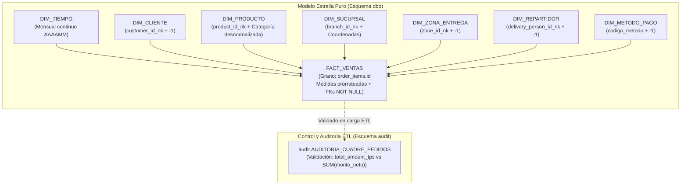

# INFORME TÉCNICO DE AUDITORÍA Y CORRECCIONES DEL DATA WAREHOUSE
## Proyecto: Juice Corner BD — Sistema Analítico TPS de Pedidos de Restaurante

---

## 1. Resumen Ejecutivo

A partir de la revisión del diagrama de base de datos implementado en SQL Server Management Studio (SSMS) para el Data Warehouse de **Juice Corner BD**, se llevó a cabo una auditoría técnica contra las especificaciones del Decálogo oficial y los requerimientos del proyecto empresarial. 

El modelo base demostró un alineamiento conceptual notable (adopción del grano atómico por línea de pedido, uso de dimensiones degeneradas y desnormalización de categorías); sin embargo, se identificaron **cuatro discrepancias críticas** que comprometían la pureza dimensional, la integridad referencial y la consistencia matemática de las métricas netas. 

Todas las observaciones fueron corregidas mediante la generación de un script de base de datos exclusivo ([`JuiceCorner_DW.sql`](file:///C:/Users/Agents/Documents/3.1proyecto/JuiceCorner_DW.sql)) y la actualización formal del Decálogo técnico a su Versión 2.0 ([`Decalogo_Data_Warehouse_Restaurante_Corregido.md`](file:///C:/Users/Agents/Documents/3.1proyecto/Docs/Decalogo_Data_Warehouse_Restaurante_Corregido.md)).

---

## 2. Diagnóstico Inicial y Observaciones del Diagrama

### Observación 1: Violación de la topología estrella pura por la tabla `AUDITORIA_CUADRE_PEDIDOS`
* **Situación:** En el diagrama físico original, la tabla `AUDITORIA_CUADRE_PEDIDOS` figuraba como una entidad huérfana (sin claves foráneas) compartiendo el mismo plano que las dimensiones y hechos.
* **Diagnóstico Kimball:** Las tablas de control del ETL no son dimensiones ni hechos analíticos. Presentarlas en el diagrama del modelo dimensional genera confusión en las herramientas de Business Intelligence (Power BI, Tableau) y rompe la arquitectura estrella pura.
* **Resolución:** Se segregó la tabla dentro de un esquema administrativo específico denominado `audit` (`audit.AUDITORIA_CUADRE_PEDIDOS`), retirándola del esquema analítico principal `dbo`.

### Observación 2: Defecto de doble descuento en la fórmula teórica de `monto_neto`
* **Situación:** El Decálogo original definía el cálculo del neto como:
  $$\text{monto\_neto} = \text{subtotal} - \text{descuentos} + \text{envío} + \text{impuesto}$$
* **Diagnóstico de Datos TPS:** Al auditar la estructura transaccional de Juice Corner (`order_items`), se comprobó que `order_items.subtotal` **ya viene neto de `order_items.discount`**. Asimismo, en la cabecera `orders.discount_amount` es exactamente la sumatoria de esos mismos descuentos de línea. Si el cálculo resta nuevamente `descuento_pedido_prorr`, el descuento se descuenta dos veces.
* **Resolución:** Se corrigió la fórmula oficial en el DDL y en el Decálogo:
  $$\text{monto\_neto} = \text{subtotal} - \text{descuento\_cupon\_prorr} + \text{costo\_envio\_prorr} + \text{impuesto\_prorr}$$
  Manteniendo `descuento_linea` y `descuento_pedido_prorr` como métricas aditivas de análisis e información, sin restarlas dos veces.

### Observación 3: Riesgo de nulos en Claves Foráneas de hechos
* **Situación:** En pedidos presenciales en salón (canal local), no existe zona de entrega ni repartidor; en pedidos sin registro no existe cliente identificado; y en pedidos cancelados puede no haber pago exitoso.
* **Diagnóstico Kimball:** Permitir valores `NULL` en las claves foráneas de una tabla de hechos degrada las consultas analíticas (*outer joins* forzados) y rompe las jerarquías de agregación en cubos OLAP.
* **Resolución:** Se definió la obligatoriedad **`NOT NULL`** en todas las FKs de `FACT_VENTAS` y se crearon formalmente los registros comodín con clave `-1` en las dimensiones correspondientes:
  * `DIM_CLIENTE`: `-1` $\rightarrow$ *"Cliente invitado"*.
  * `DIM_ZONA_ENTREGA`: `-1` $\rightarrow$ *"No aplica (Consumo en Local)"*.
  * `DIM_REPARTIDOR`: `-1` $\rightarrow$ *"No aplica (Consumo en Local)"*.
  * `DIM_METODO_PAGO`: `-1` $\rightarrow$ *"Sin pago exitoso"*.

### Observación 4: Granularidad temporal de `DIM_TIEMPO`
* **Situación:** `DIM_TIEMPO` fue definida con grano mensual (`AAAAMM`).
* **Diagnóstico Operativo:** Aunque para la contabilidad mensual y semestral es adecuada, para el análisis logístico de entrega (`minutos_entrega`) y demanda semanal se pierde la visión por día de la semana o feriados.
* **Resolución:** Se preservó el grano mensual en cumplimiento estricto del requerimiento del Decálogo, implementando una carga continua de todos los meses de 2025 y 2026 para garantizar que los meses sin ventas figuren en los reportes, y se documentó la recomendación de evolución a grano diario (`AAAAMMDD`) para fases operativas avanzadas.

### Observación 5: Alcance funcional respecto al Margen de Contribución (Fase 1)
* **Situación:** `FACT_VENTAS` contempla ventas netas y brutas, pero no incluye costos de ingredientes ni margen de contribución.
* **Diagnóstico de Negocio:** El objetivo SMART del proyecto general es *"elevar el margen de contribución global de 61,1 % a 64 %"*.
* **Resolución:** Se aclaró formalmente en el Decálogo que este modelo abarca el subsistema transaccional de ventas del TPS (pedidos/líneas). Para las Fases 4 y 5 se requerirá extender el hecho con el costo de insumos proveniente de las recetas (`product_ingredients` y `ingredients`).

### Observación 6: Definición y Unificación de Canales de Venta (Modelo Bipolar Local vs. Delivery)
* **Situación:** En los borradores iniciales se aludía genéricamente a tres modalidades de pedido: salón, para llevar (*takeaway*) y delivery.
* **Diagnóstico de Datos TPS:** La auditoría empírica del dataset transaccional [`orders.csv`](file:///C:/Users/Agents/Documents/3.1proyecto/dataset/orders.csv) (1.000.000 de registros) demostró que el 100 % de las órdenes se dividen estrictamente en dos canales: `delivery` (55,03 %, 550.264 pedidos) y `dine_in` (44,97 %, 449.736 pedidos). No existe una sola orden registrada bajo la modalidad *takeaway* (0 pedidos).
* **Resolución:** Se formalizó la operación de Juice Corner BD sobre **2 canales de atención**:
  1. **Consumo en Local (`dine_in`)**: 44,97 % del volumen. Requiere mesa física (`dining_tables`), sin despacho ni repartidor (`zona_key = -1`, `repartidor_key = -1`).
  2. **Entrega a Domicilio (`delivery`)**: 55,03 % del volumen. Requiere dirección (`customer_addresses`), zona tarifada (`DIM_ZONA_ENTREGA`) y repartidor (`DIM_REPARTIDOR`).
  Se ajustaron las restricciones del TPS (`CHECK`), la definición del atributo degenerado `tipo_pedido` en `FACT_VENTAS` y las leyendas de los registros comodín `-1`.

---

## 3. Matriz Comparativa: Antes vs. Después

| Componente | Estado Anterior (Diagrama Inicial) | Estado Corregido (JuiceCorner_DW.sql) | Justificación Técnica |
| :--- | :--- | :--- | :--- |
| **Arquitectura de Esquemas** | Todo mezclado en `dbo`, tabla de auditoría desconectada en el plano dimensional. | Esquema `dbo` para la estrella pura y esquema `audit` para tablas de control. | Separación de preocupaciones (SoC) y cumplimiento del estándar estrella de Kimball. |
| **Claves Foráneas en `FACT_VENTAS`** | Susceptibles a valores `NULL` en pedidos en salón o clientes anónimos. | Todas las 7 FKs son estrictamente **`NOT NULL`**. | Evita *outer joins* y registros huérfanos en herramientas BI. |
| **Registros Comodín (-1)** | Solo mencionados conceptualmente en texto. | Insertados físicamente mediante DDL con `IDENTITY_INSERT ON`. | Garantiza integridad referencial inmediata desde el primer despliegue. |
| **Fórmula de `monto_neto`** | Restaba dos veces el descuento (línea + pedido), fallando el cuadre con el TPS. | $\text{subtotal} - \text{cupon} + \text{envio} + \text{impuesto}$. | Consistencia matemática exacta con `orders.total_amount`. |
| **Dominio de Pagos** | Dimensión sin poblar inicialmente. | Poblada automáticamente con el enumerado de pagos del TPS (`cash`, `card`, `bkash`, etc.). | Cumple la regla de carga única del Decálogo. |
| **Restricciones de Calidad** | CHECKs parciales. | CHECKs estrictos en banderas (`'S'/'N'`), rango de calificación (`1 a 5`) y `line_count = 1`. | Asegura calidad de datos (ISO/IEC 25012) a nivel de motor. |
| **Canales Comerciales** | Mención dispersa de 3 canales (salón, para llevar, delivery). | Formalizado en 2 canales reales: `dine_in` (45,0 %) y `delivery` (55,0 %). | Eliminación de ambigüedades: `orders.csv` tiene 0 órdenes *takeaway*. |
| **Índices de Rendimiento** | Índices básicos. | Índices no agrupados en cada FK e índice compuesto `(order_id, tiempo_key, sucursal_key)`. | Optimiza `COUNT(DISTINCT order_id)` y el cálculo de tickets promedio. |

---

## 4. Archivos Entregables

1. [JuiceCorner_DW.sql](file:///C:/Users/Agents/Documents/3.1proyecto/JuiceCorner_DW.sql): Script DDL completo y reproducible en T-SQL (Microsoft SQL Server) con la creación de base de datos, tablas, esquemas, índices y pre-poblamiento de datos maestros y comodines.
2. [Decalogo_Data_Warehouse_Restaurante_Corregido.md](file:///C:/Users/Agents/Documents/3.1proyecto/Docs/Decalogo_Data_Warehouse_Restaurante_Corregido.md): Documento normativo oficial actualizado desde el principio, integrando todas las correcciones funcionales, técnicas y matemáticas.
3. [Informe_Cambios_Data_Warehouse.md](file:///C:/Users/Agents/Documents/3.1proyecto/Docs/Informe_Cambios_Data_Warehouse.md): Copia local en la carpeta `Docs/` del proyecto para archivo del equipo.
