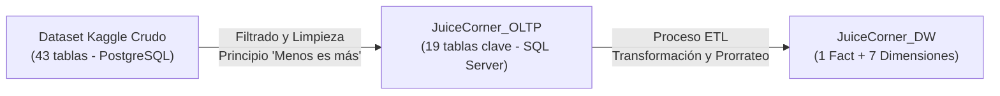
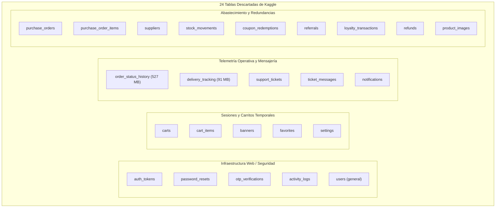

# INFORME TÉCNICO Y METODOLÓGICO: JUSTIFICACIÓN DE LA BASE DE DATOS TRANSACCIONAL (OLTP)
## Proyecto Integrador: Data Warehouse para "Juice Corner BD"
**Documento de Arquitectura de Datos y Trazabilidad**  
**Motor:** Microsoft SQL Server (T-SQL)  
**Dataset Origen:** *Restaurant & Food Delivery Relational Database* (Kaggle)  
**Fecha:** Noviembre 2026  

---

## 1. Resumen Ejecutivo y Marco del Proyecto

El proyecto **Juice Corner BD** aborda una problemática crítica identificada en la **Fase 1**: a pesar de registrar una demanda homogénea a lo largo de sus 20 productos (~250.000 unidades vendidas por producto en 162 días), la empresa experimenta márgenes de contribución sumamente dispares (desde 14,4 % en batidos hasta 94,2 % en mocktails) y aplica políticas de descuento y cupones de forma desarticulada, erosionando la rentabilidad global (61,1 %).

Para resolver este desafío mediante Inteligencia de Negocios (BI), se requiere un repositorio transaccional (**OLTP / TPS**) que sirva de cimiento confiable para alimentar un **Data Warehouse (JuiceCorner_DW)** con esquema estrella.

El dataset crudo disponible en Kaggle consta de **43 tablas relacionales** diseñadas para una plataforma web y móvil transaccional genérica en PostgreSQL. Adoptar la totalidad de esas tablas habría sobrecargado el sistema con datos de infraestructura de red, sesiones y registros de auditoría que no aportan a la toma de decisiones.

Siguiendo el principio arquitectural **"Menos es más y mejor"** y los estándares de calidad de datos (**ISO/IEC 25012**), se realizó un proceso riguroso de filtrado, normalización y adaptación técnica:
* **De 43 tablas originales de Kaggle $\to$ Se seleccionaron y estructuraron exactamente 19 tablas clave**.
* **Se descartaron 24 tablas operativas transitorias** que introducían ruido, redundancia y sobrecosto de almacenamiento.
* **Se sanearon anomalías relacionales** (bucles recursivos y dependencias transitivas redundantes) para garantizar una carga masiva íntegra y de alto rendimiento.

---

## 2. Radiografía del Dataset Origen (Kaggle)

El dataset de Kaggle representa las operaciones completas de una cadena de jugos y comida rápida en Dhaka, Bangladesh, entre el 11 de enero de 2026 y el 21 de junio de 2026. Sus volúmenes centrales son:

* **1.000.000 de pedidos** (`orders.csv` ~ 268 MB).
* **2.500.000 líneas de detalle** (`order_items.csv` ~ 117 MB).
* **1.000.000 de pagos** (`payments.csv` ~ 94 MB).
* **700.000 despachos de entrega** (`deliveries.csv` ~ 90 MB).
* **527 MB de trazas de cambio de estado** (`order_status_history.csv` — *descartado*).
* **5.000 clientes registrados** y **6 repartidores activos**.
* **20 productos de carta** distribuidos en **3 sucursales**.

---

## 3. Justificación de las 19 Tablas Clave del OLTP

Las 19 tablas que componen [`JuiceCorner_OLTP.sql`](file:///C:/Users/Agents/Documents/3.1proyecto/JuiceCorner_OLTP.sql) se agrupan en **5 dominios funcionales indispensables**. A continuación se justifica la necesidad de cada una, su volumen y su aporte directo al Data Warehouse:

### Dominio 1: Estructura Comercial, Menú y Ubicación

| # | Tabla OLTP | Archivo Kaggle | Registros | Justificación de Negocio (Por qué es clave) | Destino en el Data Warehouse |
|---|---|---|:---:|---|---|
| **1** | `categories` | `categories.csv` | 5 | Permite agrupar los 20 productos en familias comerciales (*Fresh Juices*, *Smoothies*, *Milkshakes*, *Mocktails*, *Healthy Snacks*). | Se desnormaliza dentro de `DIM_PRODUCTO` para mantener un esquema estrella puro sin copo de nieve. |
| **2** | `products` | `products.csv` | 20 | Catálogo central de venta. Contiene los precios de lista base (`price`, `discounted_price`) y atributos de temporada (`is_seasonal`). | Alimenta la dimensión `DIM_PRODUCTO`. |
| **3** | `branches` | `branches.csv` | 3 | Modela las 3 sucursales físicas en Dhaka (Dhanmondi, Gulshan, Banani). Permite la comparación geográfica de rendimiento de ventas y costos operativos. *Nota de calidad:* Uttara es una zona de delivery (`delivery_zones`), no una sucursal física. | Alimenta directamente `DIM_SUCURSAL`. |
| **4** | `dining_tables` | `dining_tables.csv` | 30 | Registra la capacidad y número de mesas de atención en local para pedidos `dine_in`. | Atributo degenerado (`numero_mesa`) en `FACT_VENTAS` para analizar rotación de mesas. |

---

### Dominio 2: Clientes y Cobertura Logística

| # | Tabla OLTP | Archivo Kaggle | Registros | Justificación de Negocio (Por qué es clave) | Destino en el Data Warehouse |
|---|---|---|:---:|---|---|
| **5** | `delivery_zones` | `delivery_zones.csv` | 5 | Define las tarifas base de envío, montos mínimos de pedido y tiempos estimados de despacho por zona de Dhaka. | Alimenta la dimensión `DIM_ZONA_ENTREGA`. |
| **6** | `customers` | `customers.csv` | 5.000 | Maestro de clientes. Almacena canales de contacto, estado de verificación telefónica/email y si el cliente fue captado por referido. | Alimenta `DIM_CLIENTE` (omitiendo contraseñas y saldos volátiles). |
| **7** | `customer_addresses` | `customer_addresses.csv` | 10.000 | Vincula las direcciones reales de los clientes con la zona de delivery asignada (`zone_id`). | Actúa como tabla puente en el ETL para resolver qué zona geográfica atendió cada pedido delivery. |
| **8** | `delivery_personnel` | `delivery_personnel.csv` + `users.csv` | 6 | Personal propio de reparto. Registra tipo de vehículo (motocicleta o bicicleta) y matrícula. | Alimenta la dimensión `DIM_REPARTIDOR`. |

---

### Dominio 3: Estrategia de Precios, Cupones y Promociones

| # | Tabla OLTP | Archivo Kaggle | Registros | Justificación de Negocio (Por qué es clave) | Destino en el Data Warehouse |
|---|---|---|:---:|---|---|
| **9** | `coupons` | `coupons.csv` | 10 | Modela los cupones de descuento global (fijos y porcentuales) que erosionan el margen según la Fase 1 (38,65 % de órdenes con cupón). | Atributo degenerado (`codigo_cupon`) e importe prorrateado (`descuento_cupon_prorr`) en `FACT_VENTAS`. |
| **10** | `promotions` | `promotions.csv` | 8 | Registra campañas temporales de marketing aplicadas directamente a grupos de productos. | Alimenta la bandera analítica `en_promocion ('S'/'N')` en `FACT_VENTAS`. |
| **11** | `product_promotions`| `product_promotions.csv` | 15 | Relación muchos a muchos que especifica qué productos participan en qué promociones activas. | Cruce en el ETL para determinar si la línea vendida gozaba de promoción. |

---

### Dominio 4: Transacciones de Venta, Pagos y Despacho (Núcleo Operativo)

| # | Tabla OLTP | Archivo Kaggle | Registros | Justificación de Negocio (Por qué es clave) | Destino en el Data Warehouse |
|---|---|---|:---:|---|---|
| **12** | `orders` | `orders.csv` | 1.000.000 | Cabecera del pedido. Contiene fechas de colocación, canal de atención exclusivo (`dine_in` [45,0 %] y `delivery` [55,0 %]; sin pedidos takeaway), estado, costo de envío, impuesto y totales. | Aporta atributos degenerados (`order_id`, `tipo_pedido`, `estado_pedido`) y las medidas de cabecera a prorratear. |
| **13** | `order_items` | `order_items.csv` | 2.500.000 | Detalle de productos solicitados. Contiene cantidad, precio cobrado, descuento de línea y subtotal de la línea. | **Define el grano de la tabla de hechos `FACT_VENTAS`** (una fila por cada línea de pedido). |
| **14** | `payments` | `payments.csv` | 1.000.000 | Registro de transacciones financieras del pedido con método de pago y estado de cobro. | Determina el método de pago exitoso de mayor monto para enlazar con `DIM_METODO_PAGO`. |
| **15** | `deliveries` | `deliveries.csv` | 700.000 | Traza logística del despacho: hora de asignación, hora de entrega y repartidor asignado. | Calcula la medida de eficiencia logística `minutos_entrega = DATEDIFF(minute, assigned_at, delivered_at)`. |
| **16** | `reviews` | `reviews.csv` | 600.000 | Calificaciones (1 a 5 estrellas) y opiniones de clientes sobre productos y pedidos. | Alimenta la medida de satisfacción del cliente `calificacion` en `FACT_VENTAS`. |

---

### Dominio 5: Costos, Recetas e Inventario (Fase 1 del Proyecto)

| # | Tabla OLTP | Archivo Kaggle | Registros | Justificación de Negocio (Por qué es clave) | Destino en el Data Warehouse |
|---|---|---|:---:|---|---|
| **17** | `ingredients` | `ingredients.csv` | 25 | Catálogo de insumos crudos (frutas, leche, azúcar, hielo, empaques) con su costo unitario real (`cost_per_unit`). | Permite calcular el Costo de Mercancía Vendida (COGS) para contrastar los márgenes de 14,4 % vs 94,2 %. |
| **18** | `product_ingredients`| `product_ingredients.csv`| 45 | Ficha técnica o escandallo de receta: indica cuántos gramos o mililitros de cada insumo consume cada producto de la carta. | Base de cálculo analítico: $\text{Costo Producto} = \sum (\text{cantidad} \times \text{costo\_insumo})$. |
| **19** | `inventory` | *(Modelo propio derivado)* | 75 | Control de stock físico de ingredientes disponible por cada una de las 3 sucursales. | Permite a la gerencia monitorear quiebres de inventario vinculados a productos de alto margen. |

---

## 4. Justificación de las 24 Tablas Excluidas de Kaggle

De las 43 tablas que componen el repositorio crudo de Kaggle, **24 fueron explícitamente descartadas**. Mantenerlas habría violado el principio de parquedad de Kimbal y generado un costo de almacenamiento y procesamiento injustificado:

### Detalle de las Razones Técnicas de Exclusión:

1. **Tablas de Sesión y Seguridad Web (`auth_tokens`, `password_resets`, `otp_verifications`, `activity_logs`):**
   * *Razón:* Almacenan hashes de contraseñas, tokens de autenticación móvil y logs de clics HTTP. No contienen información de negocio y constituyen un riesgo de seguridad de datos personales.
2. **Tablas Transitorias de Carrito (`carts`, `cart_items`):**
   * *Razón:* Guardan selecciones efímeras de la app antes de pagar. El análisis de compras se realiza exclusivamente sobre las ventas consumadas (`orders` y `order_items`).
3. **Telemetría y Tracking en Tiempo Real (`delivery_tracking`, `order_status_history`):**
   * *Razón:* `order_status_history.csv` pesa **527 MB** (más del doble que todos los pedidos juntos) y solo guarda la hora exacta en que una orden cambió a `in_prep` o `ready`. El Data Warehouse analiza el ciclo total de despacho mediante `deliveries.assigned_at` y `deliveries.delivered_at`.
4. **Soporte y Mensajería (`support_tickets`, `ticket_messages`, `notifications`):**
   * *Razón:* Corresponden al módulo de atención al cliente (reclamos de entrega tardía). El decálogo del proyecto mide la satisfacción cuantitativamente a través de `reviews.rating` (1 a 5 estrellas).
5. **Redundancias de Transacción (`coupon_redemptions`, `referrals`, `loyalty_transactions`):**
   * *Razón:* El uso de cupones ya está registrado en `orders.coupon_id` y `orders.coupon_discount`. Duplicar esa información en tablas satélite crearía múltiples fuentes de verdad contable.
6. **Módulo de Compras de Insumos (`purchase_orders`, `purchase_order_items`, `suppliers`, `stock_movements`):**
   * *Razón:* El alcance de la Fase 1 y el Decálogo se centra en el **análisis de rentabilidad de la carta y ventas**. El costo unitario de ingredientes ya está consolidado en `ingredients.cost_per_unit`.

---

## 5. Decisiones de Diseño Arquitectural: "Menos es Más y Mejor"

Al construir [`JuiceCorner_OLTP.sql`](file:///C:/Users/Agents/Documents/3.1proyecto/JuiceCorner_OLTP.sql), se resolvieron cuatro problemas estructurales presentes en el esquema original:

### 1. Eliminación del Bucle Autorreferencial en `customers`
* **Problema:** En Kaggle existía `FK_customers_referred_by` (`customers.referred_by` $\to$ `customers.id`). Al importar 5.000 clientes, si el cliente 10 fue invitado por el cliente 200, el motor SQL Server abortaba la carga por intentar validar una clave que aún no existía.
* **Solución:** Se mantuvo la columna `referred_by INT NULL` pero se suprimió la restricción física `CONSTRAINT FK...`. El DW sigue calculando `es_referido = 'S'` si `referred_by IS NOT NULL`, logrando una importación limpia y sin bloqueos.

### 2. Eliminación de la Clave Foránea Redundante en `reviews`
* **Problema:** La tabla `reviews` poseía foráneas simultáneas hacia `orders` y hacia `customers`. Dado que el pedido ya contiene a qué cliente pertenece (`orders.customer_id`), la relación directa `reviews` $\to$ `customers` representaba una **dependencia transitiva redundante** y violaba la Tercera Forma Normal (3FN).
* **Solución:** Se eliminó `FK_reviews_customers`. El cliente que dejó la reseña se deduce unívocamente a través del `order_id`.

### 3. Modelo Limpio de Pagos (`payments.method`)
* **Problema:** Se debatió incorporar una tabla intermedia `payment_methods` con una columna `id_metodos`. Esto ensuciaba el OLTP duplicando datos con los 6 textos del CSV (`cash`, `card`, `bkash`, `nagad`, `rocket`, `gateway`).
* **Solución:** Se conservó únicamente la columna `method VARCHAR(50)` con una restricción `CHECK`. El catálogo formal de métodos de pago con clave sustituta entera vive de forma centralizada en el Data Warehouse (`DIM_METODO_PAGO`).

### 4. Precarga de Repartidores (`delivery_personnel`)
* **Problema:** En Kaggle, `delivery_personnel.csv` solo tiene `user_id` y omite el nombre y teléfono del repartidor (alojados en `users.csv`), lo que hacía fallar cualquier inserción directa por restricciones `NOT NULL`.
* **Solución:** Dado que toda la cadena opera con exactamente **6 repartidores**, el script OLTP los precarga con sus nombres y teléfonos reales, dejando la tabla inmediatamente lista para operar.

---

## 6. Matriz de Trazabilidad: Kaggle $\to$ OLTP $\to$ Data Warehouse

| Entidad / Concepto | Archivo Origen Kaggle | Tabla en `JuiceCorner_OLTP` | Destino en `JuiceCorner_DW` | Rol en la Toma de Decisiones (Fase 1) |
|---|---|---|---|---|
| **Línea de Venta** | `order_items.csv` | `order_items` | `FACT_VENTAS` (Grano) | Permite evaluar cuántas unidades se venden de cada producto y calcular márgenes reales por línea. |
| **Cabecera y Costos** | `orders.csv` | `orders` | `FACT_VENTAS` (Prorrateo) | Prorratea el flete, impuestos y cupones para validar el cuadre financiero ($\sum \text{monto\_neto} = \text{total\_amount}$). |
| **Tiempo de Venta** | `orders.placed_at` | `orders.placed_at` | `DIM_TIEMPO` | Análisis de estacionalidad mensual y semestral de la demanda. |
| **Catálogo de Bebidas** | `products.csv` + `categories.csv` | `products` + `categories` | `DIM_PRODUCTO` | Identifica qué categoría de bebidas aporta mayor margen de contribución. |
| **Comprador** | `customers.csv` | `customers` | `DIM_CLIENTE` | Compara el comportamiento de compra de clientes referidos vs. clientes orgánicos. |
| **Sucursal Física** | `branches.csv` | `branches` | `DIM_SUCURSAL` | Compara la rentabilidad y volumen entre las 3 sucursales físicas reales (Dhanmondi, Gulshan y Banani). |
| **Ubicación Delivery** | `delivery_zones.csv` | `delivery_zones` | `DIM_ZONA_ENTREGA` | Evalúa si las tarifas de envío cubren los costos operativos por zona geográfica. |
| **Flota Logística** | `delivery_personnel.csv` | `delivery_personnel` | `DIM_REPARTIDOR` | Mide la eficiencia y tiempos promedio de entrega por tipo de vehículo (moto vs. bicicleta). |
| **Canal Financiero** | `payments.method` | `payments` | `DIM_METODO_PAGO` | Analiza el peso de pagos digitales móviles (*bKash*, *Nagad*, *Rocket*) frente a efectivo y tarjeta. |
| **Recetas y Costeo** | `ingredients.csv` + `product_ingredients.csv` | `ingredients` + `product_ingredients` | Módulo de Costos / Fase 1 | Permite corregir la disparidad de márgenes (14,4 % vs 94,2 %) ajustando recetas o precios de lista. |

---

## 7. Conclusión

La base de datos definida en [`JuiceCorner_OLTP.sql`](file:///C:/Users/Agents/Documents/3.1proyecto/JuiceCorner_OLTP.sql) representa el **conjunto mínimo suficiente de datos de alta fidelidad**:
1. Es **100 % compatible** con la volumetría transaccional de Kaggle (1 millón de órdenes y 2,5 millones de detalles).
2. Es **técnicamente limpia**: libre de ciclos de clave foránea redundantes y con tipos de datos nativos optimizados para Microsoft SQL Server.
3. Es **estrictamente funcional al Data Warehouse**: cada una de sus 19 tablas tiene una justificación directa en el esquema estrella analítico (`JuiceCorner_DW`) y responde a las preguntas de rentabilidad planteadas en la Fase 1.
