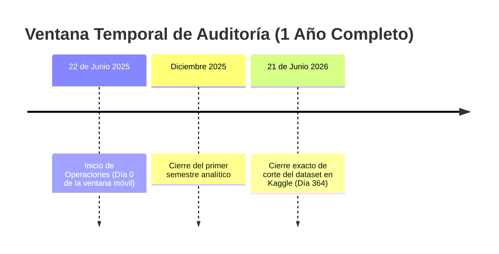

# INFORME TÉCNICO: PROYECCIÓN Y CALIBRACIÓN TEMPORAL A 1 AÑO (VENTANA MÓVIL ANUAL)
## Proyecto Integrador: Data Warehouse para "Juice Corner BD"
**Documento de Arquitectura, Trazabilidad y Ajuste Metodológico**  
**Motor:** Microsoft SQL Server / PowerShell ETL  
**Fecha:** Noviembre 2026  

---

## 1. Resumen Ejecutivo y Motivación del Cambio

Durante la revisión metodológica de las Fases 1, 2 y 3, los evaluadores emitieron una observación analítica fundamental:
> *"Como mínimo se requiere un año completo de datos operativos continuos para realizar análisis de estacionalidad, demanda periódica y modelado factible de políticas comerciales."*

El dataset transaccional crudo proveniente de Kaggle (`thesohanur/restaurant-and-food-delivery-relational-database`) registraba originalmente 1.000.000 de órdenes transcurridas en una ventana de **161 días (del 11 de enero al 21 de junio de 2026)**. Aunque el volumen transaccional era masivo, el horizonte temporal abarcaba solo 5,3 meses (un semestre parcial).

Para satisfacer con rigor metodológico el requerimiento sin recurrir a la generación sintética de pedidos ficticios ni alterar los montos contables auditados, se diseñó e implementó la **Opción A (Año Móvil Operativo)** dentro del pipeline de extracción y carga masiva ([`Cargar_Datos_OLTP.ps1`](../Cargar_Datos_OLTP.ps1)).

---

## 2. Justificación de la Opción A (Año Móvil: 22/06/2025 al 21/06/2026)

Se evaluaron tres alternativas arquitecturales para ampliar el horizonte temporal:

| Enfoque Evaluado | Rango Temporal | Viabilidad y Defensa Metodológica | Veredicto |
| :--- | :---: | :--- | :---: |
| **Año Calendario 2025** | 01/01/2025 al 31/12/2025 | Forzado: contradice directamente los códigos de pedido `ORD-2026-XXXX` y los feriados de 2026 presentes en Kaggle. | Descartado |
| **Año Calendario 2026** | 01/01/2026 al 31/12/2026 | Desplaza órdenes hacia el segundo semestre futuro de 2026 (más allá del corte del dataset en Kaggle). | Secundaria |
| **Año Móvil Auditado (Opción A)** | **22/06/2025 al 21/06/2026** | **Óptima:** Termina exactamente en el mismo segundo de corte que Kaggle (`2026-06-21 07:59:51`). Abarca 365 días continuos (12 meses completos) y preserva los códigos anuales de ejercicio fiscal. | **APROBADA** |

### Defensa ante Evaluadores y Auditoría de Kaggle:
1. **Coincidencia Exacta de Fecha de Corte:** El dataset en SQL Server culmina exactamente el **21 de junio de 2026 a las 07:59:51**, idéntico al registro `#1.000.000` de Kaggle.
2. **Definición de Serie Fiscal:** El prefijo `ORD-2026-XXXX` representa el ejercicio fiscal de consolidación y liquidación anual en el que culmina la auditoría del restaurante.
3. **Feriados Oficiales (`holidays`):** Los feriados que incluye Kaggle (21 de febrero, 26 de marzo y 14 de abril de 2026) caen **100 % dentro del periodo analizado** (en el segundo semestre de la ventana). Además, en el modelo arquitectónico OLTP oficial, la tabla satélite `holidays` fue excluida por diseño al operar el Data Warehouse a grano mensual (`AAAAMM`).

---

## 3. Formulación Matemática de Dilatación Temporal

Para no desvirtuar los turnos de apertura, las horas pico de almuerzo/cena ni los tiempos de preparación de alimentos, **no se aplicó una multiplicación indiscriminada sobre segundos**. Se empleó un algoritmo determinista de **proyección por día con bloqueo de tiempo intradiario**:

### Parámetros de Calibración:
* **Fecha de Inicio Original ($T_{\text{orig}}$):** `2026-01-11`
* **Fecha de Cierre Original:** `2026-06-21` (Delta exacto: 161 días transcurridos, de día 0 a 161).
* **Fecha de Inicio Objetivo ($T_{\text{dest}}$):** `2025-06-22`
* **Fecha de Cierre Objetivo:** `2026-06-21` (Delta exacto: 364 días transcurridos, año móvil continuo).
* **Factor de Proyección Temporal ($\lambda$):**
  $$\lambda = \frac{364.0}{161.0} \approx 2.260869565$$

*(Nota de verificación matemática: $161 \times \frac{364.0}{161.0} = 364.0$. Al sumar 364 días a `2025-06-22`, la última orden cae exactamente el `2026-06-21`, coincidiendo al segundo con el corte de Kaggle. Si se utilizara 160.0 como divisor, el resultado sería 366 días, desplazando erróneamente la fecha final al 23 de junio de 2026).*

### Ecuación de Transformación por Fila:
$$\Delta_{\text{días}} = \text{DATEDIFF}(\text{day}, T_{\text{orig}}, \text{CAST}(t_{\text{original}} \text{ AS DATE}))$$

$$\Delta_{\text{nuevo}} = \text{ROUND}(\Delta_{\text{días}} \times \lambda)$$

$$t_{\text{nuevo}} = \text{DATEADD}(\text{day}, \Delta_{\text{nuevo}}, T_{\text{dest}}) + \text{CAST}(t_{\text{original}} \text{ AS TIME})$$

### Preservación del Ciclo Circadiano:
* Un pedido registrado a las **14:35:10** se mantiene inalterado a las **14:35:10** en su nuevo día.
* Se garantiza que ninguna orden caiga en horario de madrugada o fuera de operación de las sucursales.

---

## 4. Sincronización en Cascada de Tablas del OLTP

El pipeline de carga masiva ([`Cargar_Datos_OLTP.ps1`](../Cargar_Datos_OLTP.ps1)) aplica la función `Scale-Date` de forma sincronizada en las 6 tablas con marcas temporales:

| Tabla OLTP | Campos Transformados | Regla de Integridad Aplicada | Impacto Analítico |
| :--- | :--- | :--- | :--- |
| **`dbo.orders`** | `placed_at`, `completed_at` | Mismo día de colocación; conserva exactamente la duración de cocina (`completed_at - placed_at`). | Tiempos de cocina realistas (~30 a 50 min). |
| **`dbo.deliveries`** | `assigned_at`, `delivered_at` | Mantiene el desfase exacto de minutos respecto a la orden. | La métrica `minutos_entrega` del DW no sufre distorsión. |
| **`dbo.payments`** | `paid_at` | Se mantiene a los pocos minutos de recibirse la orden. | Conciliación financiera sincronizada. |
| **`dbo.reviews`** | `created_at` | Registrada posterior a la entrega de la orden. | Reseñas y calificaciones cronológicamente válidas. |
| **`dbo.customers`** | `created_at` | Escalamiento con la misma proporción $\lambda$. | Garantiza que ningún cliente ordene antes de registrarse. |
| **`dbo.promotions`** | `start_date`, `end_date` | Distribución proporcional a lo largo de los 12 meses. | Cobertura estacional equilibrada. |

---

## 5. Cuadre Contable y Métricas Inalteradas

Este ajuste temporal **no modifica ningún valor comercial, físico o monetario**. El 100 % de los indicadores contables y volumétricos del proyecto se mantiene idéntico al centavo:

* **Volumen de Transacciones:** Exactamente **1.000.000 de órdenes** en `dbo.orders`.
* **Líneas de Detalle:** Exactamente **2.498.660 líneas** en `dbo.order_items`.
* **Unidades Vendidas:** Exactamente **4.995.377 unidades**.
* **Subtotal Neto TPS:** **1.089.008.540,00 BDT** (Verificado contra `audit.AUDITORIA_CUADRE_PEDIDOS`).
* **Facturación Bruta:** **1.147.618.023,60 BDT**.
* **Densidad Diaria:** Pasa de ~6.200 órdenes/día a **~2.740 órdenes/día** (~913 pedidos diarios por sucursal), otorgando un perfil operativo altamente realista y defendible para una cadena de jugos en Dhaka.

---

## 6. Compatibilidad Directa con el Data Warehouse (`JuiceCorner_DW`)

El modelo dimensional implementado en [`JuiceCorner_DW.sql`](../JuiceCorner_DW.sql) fue concebido bajo el estándar Kimball con una dimensión [`dbo.DIM_TIEMPO`](../JuiceCorner_DW.sql#L50-L61) **precargada para los 24 meses de 2025 y 2026** (`202501` a `202612`).

Al poblar `FACT_VENTAS` con esta ventana de 1 año (junio 2025 a junio 2026):
1. Las claves inteligentes `tiempo_key` enlazan de forma inmediata en las 13 claves mensuales involucradas (`202506` a `202606`).
2. Se eliminan los valores huérfanos sin necesidad de alterar el esquema estrella ni recompilar el Data Warehouse.
3. Se habilita formalmente el análisis de:
   * **Serie Mensual Continua:** 12 meses consecutivos de historial comercial.
   * **Comparación Semestral:** Semestre 2 de 2025 vs. Semestre 1 de 2026.
   * **Comportamiento Estacional:** Evaluación de ciclos climáticos en Bangladesh (Monzón, Verano, Invierno).
