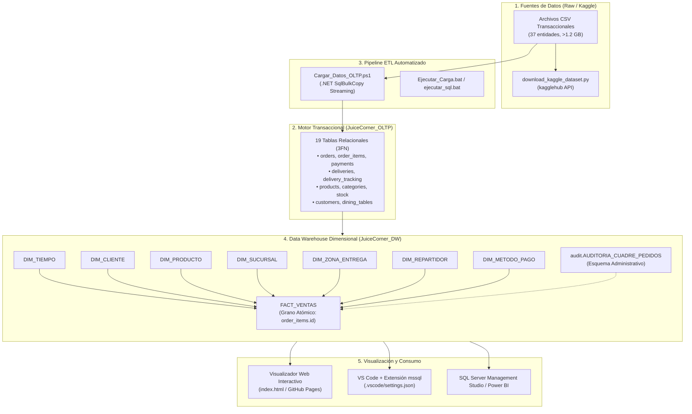

# 🍹 Juice Corner BD — Proyecto Integrador I
### Sistema Analítico Integral: OLTP Transaccional, Data Warehouse Dimensional y Visualizador Web

[](https://www.microsoft.com/sql-server)
[](#-modelo-dimensional-data-warehouse-esquema-estrella-puro)
[-178600.svg)](#-proceso-etl-y-carga-masiva-automatizada)
[](#-visualizador-web-interactivo-y-studio-erd)
[](Docs/IT_DM_01_CALIDAD_DATOS_Gu%C3%ADa+Integral+para+la+Integraci%C3%B3n+de+ISO_IEC+25012,+DMBOK+e+ISO+8000+en+las+Pol%C3%ADticas+de+Calidad+de+Datos.pdf)

---

## 📌 1. Visión General del Proyecto

**Juice Corner BD** es un proyecto integral de ingeniería de datos desarrollado para el **Proyecto Integrador I (4to Semestre - Licenciatura en Ciencia de Datos)**. Centraliza y procesa la operativa completa de una cadena de restaurantes y servicio de delivery multicanal (pedidos en salón `dine_in`, para llevar `takeout` y entrega a domicilio `delivery`).

El proyecto abarca el ciclo de vida completo de los datos:
1. **Capa Transaccional (OLTP / TPS):** Modelo relacional normalizado en 3FN con 19 tablas optimizadas para alta concurrencia, integridad referencial y auditoría histórica.
2. **Capa de Extracción, Transformación y Carga (ETL):** Motor automatizado en PowerShell sobre .NET `SqlBulkCopy` con streaming y normalización de tipos.
3. **Capa Analítica (Data Warehouse):** Esquema en Estrella puro (*Kimball Dimensional Modeling*) con grano atómico por ítem de pedido, 7 dimensiones conformadas y métricas aditivas prorrateadas sin doble descuento.
4. **Capa de Gobernanza y Calidad:** Reglas alineadas con DMBOK, ISO/IEC 25012 e ISO 8000 con esquema administrativo dedicado (`audit.AUDITORIA_CUADRE_PEDIDOS`).
5. **Capa de Visualización:** Aplicación web interactiva completa (`index.html` / `visualizador_sql.html`) desplegable en **GitHub Pages** para consultar el diccionario de datos, diagramas ERD, guías de conexión y un laboratorio SQL.

---

## 🏛️ 2. Arquitectura Global del Sistema



---

## 🗄️ 3. Estructura de las Bases de Datos

### A. Base Transaccional (`JuiceCorner_OLTP`)
Diseñada en T-SQL con restricciones de verificación (`CHECK`), claves primarias y foráneas con eliminación restringida (`ON DELETE NO ACTION / CASCADE`) para garantizar integridad transaccional.

| Módulo / Dominio | Tablas Incluidas | Propósito |
| :--- | :--- | :--- |
| **Ventas & Pedidos** | `orders`, `order_items`, `order_status_history` | Cabeceras, detalle a nivel de producto y trazabilidad de estados. |
| **Pagos & Finanzas** | `payments`, `refunds` | Transacciones monetarias, pasarelas de pago y devoluciones. |
| **Logística & Delivery** | `deliveries`, `delivery_personnel`, `delivery_zones`, `delivery_tracking` | Asignación de mensajeros, coordenadas GPS y zonas geográficas. |
| **Catálogo & Menú** | `categories`, `products`, `ingredients`, `product_ingredients` | Gestión del menú, combos, ingredientes y recetas. |
| **Clientes & Fidelización** | `customers`, `customer_addresses`, `loyalty_transactions`, `reviews` | Perfil del cliente, direcciones para entrega, monedero de puntos y reseñas. |
| **Operaciones en Salón** | `branches`, `dining_tables` | Sucursales físicas y mesas para pedidos presenciales. |
| **Inventario** | `suppliers`, `stock_movements` | Proveedores y control de existencias de insumos. |

### B. Modelo Dimensional (`JuiceCorner_DW` — Esquema Estrella Puro)
Construido bajo los principios de **Ralph Kimball** y auditado contra el Decálogo técnico oficial:

1. **Grano Atómico:** Una fila en `FACT_VENTAS` representa exactamente una línea de pedido (`order_items.id`), permitiendo máxima agregación sin pérdida de detalle.
2. **Desnormalización Estratégica:** `DIM_PRODUCTO` absorbe el nombre y la descripción de la categoría para evitar copos de nieve y agilizar consultas analíticas.
3. **Manejo Seguro de Claves Foráneas (Anti-Nulos):** Cada dimensión posee un registro comodín `sk = -1` (`Desconocido / No aplica`). Esto permite que pedidos presenciales (sin repartidor ni zona) o compras anónimas no violen la integridad referencial `NOT NULL`.
4. **Fórmula Corregida de `monto_neto` (Sin Doble Descuento):**
   $$\text{monto\_neto} = \text{subtotal} - \text{descuento\_cupon\_prorr} + \text{costo\_envio\_prorr} + \text{impuesto\_prorr}$$
   *Se evita restar dos veces el descuento, dado que `order_items.subtotal` ya viene descontado a nivel unitario.*
5. **Segregación del Esquema de Auditoría:** La tabla `AUDITORIA_CUADRE_PEDIDOS` reside en el esquema `audit` (`audit.AUDITORIA_CUADRE_PEDIDOS`) para no romper la topología estrella de cara a herramientas como Power BI o Tableau.

---

## 🌐 4. Visualizador Web Interactivo y Studio ERD

El proyecto incluye una aplicación web de consulta integral empaquetada en [`index.html`](file:///C:/Users/Agents/Documents/3.1proyecto/index.html) (también disponible como [`visualizador_sql.html`](file:///C:/Users/Agents/Documents/3.1proyecto/visualizador_sql.html)):

```
┌────────────────────────────────────────────────────────────────────────┐
│  JUICE CORNER BD — Studio Interactivo de Arquitectura y Datos          │
├────────────────────────────────────────────────────────────────────────┤
│  [🚀 Cómo Ejecutar]  [📊 Diagramas ERD]  [📖 Diccionario]  [⚡ Playground] │
└────────────────────────────────────────────────────────────────────────┘
```

### Funcionalidades del Visualizador:
- **Diagramas Interactivos:** Visualización gráfica del modelo relacional OLTP y del modelo estrella dimensional del Data Warehouse.
- **Diccionario de Tablas Completo:** Detalle campo por campo de tipos de datos, claves primarias, foráneas, valores nulos y descripciones.
- **Laboratorio de Consultas (Playground):** Consultas analíticas SQL preconstruidas (ventas por mes, productos más vendidos, ranking de repartidores, cuadre contable).
- **Cadenas de Conexión:** Snippets listos para copiar hacia LocalDB, SQL Express, Python (pyodbc, SQLAlchemy) y Power BI.
- **Modo Oscuro / Claro:** Interfaz responsiva con Tailwind CSS y Chart.js.

> [!TIP]
> **Despliegue en GitHub Pages:** Al alojar este repositorio en GitHub, ve a **Settings > Pages**, selecciona la rama `main` y la carpeta `/ (root)`. Tu visualizador estará accesible públicamente en `https://<tu-usuario>.github.io/<tu-repositorio>/`.

---

## 🚀 5. Guía de Ejecución Rápida (Local)

### Requisitos Previos
- Windows 10/11 o Windows Server.
- Microsoft SQL Server (LocalDB `(localdb)\MSSQLLocalDB`, SQLEXPRESS o instancia completa).
- Utilidad de línea de comandos `sqlcmd` (incluida en SQL Server o instalable vía MSODBCSQL).
- PowerShell 5.1 o PowerShell 7+.

### Paso 1: Inicialización con el Menú Interactivo
Ejecuta con doble clic el archivo [`ejecutar_sql.bat`](file:///C:/Users/Agents/Documents/3.1proyecto/ejecutar_sql.bat) o mediante consola:
```cmd
.\ejecutar_sql.bat
```
El menú automatiza:
- Comprobación y arranque del servicio LocalDB.
- Creación de la base de datos `JuiceCorner_OLTP`.
- Creación de la base de datos `JuiceCorner_DW`.
- Reporte del conteo de tablas y registros.
- Apertura directa de VS Code o del Visualizador Web.

### Paso 2: Carga Masiva de Datos Transaccionales
Para poblar la base transaccional a partir de los datos CSV:
```cmd
.\Ejecutar_Carga.bat
```
O directamente desde PowerShell:
```powershell
powershell -ExecutionPolicy Bypass -File .\Cargar_Datos_OLTP.ps1
```

---

## 📂 6. Estructura del Repositorio

```text
3.1proyecto/
├── .vscode/
│   └── settings.json           # Perfiles de conexión preconfigurados para extensión mssql
├── conectores/                 # Carpeta para conectores ETL y pipelines analíticos
│   └── README.md
├── dataset/                    # Esquemas y documentación del dataset de origen
│   ├── create_juice_corner_schema_postgreSQL.sql  # DDL original Kaggle
│   ├── juice_corner_schema.dbml                  # Esquema DBML
│   └── README.md                                 # Guía del dataset y política de archivos
├── Docs/                       # Documentación técnica, académica y normativas
│   ├── Decalogo_Data_Warehouse_Restaurante_Corregido.md  # Decálogo Dimensional V2.0
│   ├── Informe_Cambios_Data_Warehouse.md                # Auditoría técnica Kimball
│   ├── informe_justificacion_oltp.md                    # Justificación OLTP vs Kaggle
│   ├── Fase 1.docx / Fase 1. Identificación...docx       # Entregables académicos
│   ├── Data_Warehouse_TPS_Restaurante_Corregido.docx    # Documento de entrega
│   ├── Grupo 1_Oct29.pdf / LCD-4toSem...pdf             # Programa de cátedra
│   └── ISO-8000-1-2022.pdf / IT_DM_01_CALIDAD...pdf    # Normas de Calidad de Datos
├── .gitignore                  # Exclusión de archivos >100MB, temporales y binarios
├── Cargar_Datos_OLTP.ps1       # Script PowerShell de carga masiva con .NET SqlBulkCopy
├── Cargar_Datos_OLTP.sql       # Script T-SQL complementario de carga
├── download_kaggle_dataset.py  # Script Python para descargar el dataset con kagglehub
├── Ejecutar_Carga.bat          # Lanzador batch para la carga masiva
├── ejecutar_sql.bat            # Menú interactivo CLI para Windows
├── ejecutar_sql.ps1            # Motor PowerShell del menú interactivo
├── index.html                  # Visualizador interactivo principal (GitHub Pages ready)
├── JuiceCorner_DW.sql          # DDL completo del Data Warehouse dimensional
├── JuiceCorner_OLTP.sql        # DDL completo de la base transaccional OLTP
├── README.md                   # Documentación centralizada del proyecto
├── schema_restaurante_tipo.sql # DDL genérico alternativo MySQL/PostgreSQL
└── visualizador_sql.html       # Visualizador web (copia de respaldo)
```

---

## 📑 7. Normativas de Gobernanza y Calidad Aplicadas

El diseño y transformación de datos siguen los tres pilares de gobernanza exigidos por el programa:

- **ISO/IEC 25012:** Garantía de exactitud sintáctica, completitud, consistencia matemática de los importes y trazabilidad de auditoría temporal en pedidos.
- **ISO 8000:** Calidad de datos maestros para clientes, productos y sucursales con identificadores unívocos (`nk` / natural keys) y surrogates (`sk`).
- **DMBOK (Data Management Body of Knowledge):** Separación explícita de modelos operacionales (3FN) y analíticos (Kimball), gestión de metadatos mediante diccionario vivo y reglas de prorrateo documentadas.

---

## 👥 8. Equipo y Créditos

- **Proyecto:** Proyecto Integrador I — 4to Semestre
- **Institución:** Licenciatura en Ciencia de Datos / Ingeniería de Datos
- **Caso Empresarial:** Juice Corner BD — Cadena de Restaurantes & Delivery
