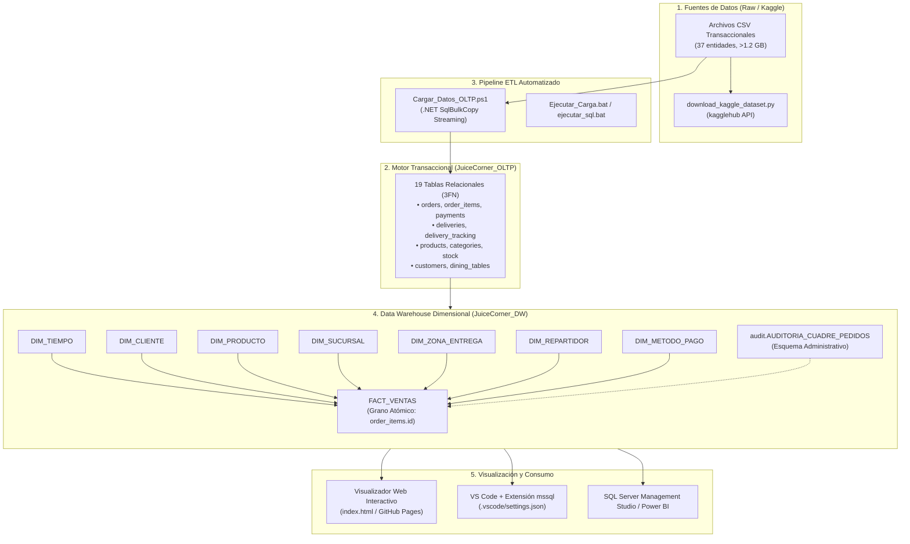

# Juice Corner BD — Proyecto Integrador I
### Sistema Analítico Integral: OLTP Transaccional, Data Warehouse Dimensional y Visualizador Web

[](https://www.microsoft.com/sql-server)
[](#paso-2-carga-masiva-de-datos-transaccionales)
[](https://joseferm.github.io/JuiceCorner-DataScience/)
[](https://github.com/JoseFerM/JuiceCorner-DataScience)
[](#9-normativas-de-gobernanza-y-calidad-aplicadas)

---

## 1. Visión General del Proyecto

**Juice Corner BD** es un proyecto integral de ingeniería de datos desarrollado para el **Proyecto Integrador I (4to Semestre - Licenciatura en Ciencia de Datos)**. Centraliza y procesa la operativa completa de una cadena de restaurantes y servicio de delivery multicanal (pedidos en salón `dine_in` y entrega a domicilio `delivery`).

El proyecto abarca el ciclo de vida completo de los datos:
1. **Capa Transaccional (OLTP / TPS):** Modelo relacional normalizado en 3FN con 19 tablas optimizadas para alta concurrencia, integridad referencial y auditoría histórica.
2. **Capa de Extracción, Transformación y Carga (ETL):** Motor automatizado en PowerShell sobre .NET `SqlBulkCopy` con streaming y normalización de tipos.
3. **Capa Analítica (Data Warehouse):** Esquema en Estrella puro (*Kimball Dimensional Modeling*) con grano atómico por ítem de pedido, 7 dimensiones conformadas y métricas aditivas prorrateadas sin doble descuento.
4. **Capa de Gobernanza y Calidad:** Reglas alineadas con DMBOK, ISO/IEC 25012 e ISO 8000 con esquema administrativo dedicado (`audit.AUDITORIA_CUADRE_PEDIDOS`).
5. **Capa de Visualización:** Aplicación web interactiva completa (`index.html`) desplegada en **GitHub Pages** para consultar el diccionario de datos, diagramas ERD, guías de conexión y laboratorio SQL.

---

## 2. Estado de Avance del Proyecto (Fases 1 a 3)

El desarrollo del proyecto se estructura en fases secuenciales que van desde la captura operacional hasta la analítica avanzada. Actualmente, el proyecto concentra sus entregables implementados hasta la **Fase 3**:

### Fase 1: Identificación del Problema, Gobernanza y Modelo Relacional
- **Diagnóstico del Problema de Negocio:** Se identificó la falta de control en la rentabilidad neta provocada por la aplicación desordenada de cupones y descuentos comerciales, ausencia de trazabilidad operativa entre salón y delivery, y necesidad de conciliación contable entre pasarelas de pago y facturación devengada.
- **Modelo Relacional Transaccional (3FN):** Diseño e implementación de 19 tablas en Microsoft SQL Server (`JuiceCorner_OLTP.sql`) que garantizan integridad referencial estricta, restricciones `CHECK` de dominio para estados y canales, y soporte histórico.
- **Marco de Gobernanza de Datos:** Adopción de normas internacionales:
  - **ISO 8000:** Gestión de datos maestros e identificadores naturales (`nk`).
  - **ISO/IEC 25012:** Control de exactitud, completitud y consistencia matemática de importes.
  - **DMBOK:** Separación formal entre entornos operacionales (3FN) y analíticos (Dimensional).

### Fase 2: Arquitectura del Data Warehouse y Pipeline ETL
- **Modelado Dimensional Kimball:** Implementación del Data Warehouse en esquema estrella puro (`JuiceCorner_DW.sql`) con:
  - **Grano Atómico:** Tabla de hechos `FACT_VENTAS` a nivel de línea de pedido individual (`order_items.id`).
  - **Dimensiones Conformadas:** Tiempo, Cliente, Producto (con categoría desnormalizada), Sucursal, Zona de Entrega, Repartidor y Método de Pago.
  - **Manejo Seguro de Nulos:** Claves artificiales comodín `sk = -1` (`No aplica / Desconocido`) para evitar violaciones de clave foránea en pedidos presenciales o clientes anónimos.
  - **Auditoría Segregada:** Creación del esquema administrativo `audit.AUDITORIA_CUADRE_PEDIDOS` para no romper la topología estrella de cara a herramientas de BI.
- **Pipeline ETL Masivo:** Script de carga automatizada en PowerShell (`Cargar_Datos_OLTP.ps1`) y ejecutable batch (`Ejecutar_Carga.bat`) basado en .NET `SqlBulkCopy` con procesamiento por lotes en streaming.
- **Visualizador Web Interactivo:** Aplicación completa de consulta en `index.html` con diagramas interactivos, diccionario de tablas y playground SQL, publicada en GitHub Pages.

### Fase 3: Análisis Estadístico y Exploratorio de Datos (EDA)
- **Análisis Descriptivo de Volúmenes y Canales:**
  - Caracterización del modelo bipolar de atención: **55,03 %** Delivery (550.264 pedidos) vs. **44,97 %** Salón (449.736 pedidos).
  - Distribución de frecuencias, medidas de tendencia central (media, mediana) y dispersión (desviación estándar, rangos intercuartílicos P25/P75/P95) del valor bruto y neto de los tickets.
- **Evaluación Estadística de Promociones y Descuentos:**
  - Medición del impacto de cupones de cabecera (`orders.coupon_discount`) vs. descuentos a nivel de producto (`order_items.discount`).
  - Detección y corrección de la anomalía de doble descuento en las fórmulas analíticas originales.
  - Análisis de variabilidad de ticket medio en compras con cupón activo frente a compras a precio regular.
- **Métricas de Eficiencia Logística:**
  - Tiempos de ciclo logístico: distribución temporal desde la asignación del pedido hasta la entrega efectiva por zona geográfica (`delivery_zones`) y repartidor (`delivery_personnel`).
  - Identificación de valores atípicos (*outliers*) en demoras de entrega y correlación con calificaciones de clientes (`reviews.rating`).

---

## 3. Plan de Expansión Estratégica (Marketing y Financiera)

Con la base de datos transaccional, el Data Warehouse y el análisis estadístico base consolidados, el plan de trabajo continuará en las siguientes áreas de especialización analítica:

### A. Dimensión de Marketing (Customer Analytics y Optimización Comercial)
1. **Segmentación de Clientes mediante Modelo RFM:**
   - Construcción de métricas de **Recencia (R)**, **Frecuencia (F)** y **Valor Monetario (M)** a partir del histórico de pedidos para agrupar a los clientes en segmentos operativos (Clientes Champions, Leales, Prometedores, En Riesgo e Inactivos).
   - Cruce de la segmentación con la acumulación y canje del programa de fidelización (`loyalty_transactions`).
2. **Efectividad y Elasticidad de Cupones y Promociones:**
   - Cálculo de la tasa de redención efectiva por campaña (`coupon_redemptions`), identificando el retorno de inversión comercial (ROI) y el Costo de Adquisición de Clientes (CAC) por canal.
   - Medición de la elasticidad precio de la demanda para determinar si los descuentos generan volumen incremental genuino o canibalizan el margen del negocio.
3. **Análisis de Canasta de Mercado (Market Basket Analysis):**
   - Minería de reglas de asociación (algoritmos Apriori y FP-Growth) sobre el detalle de productos (`order_items`) para descubrir combinaciones frecuentes y sugerir combos comerciales personalizados (cross-selling y up-selling).
4. **Modelado Predictivo de Churn (Abandono de Clientes):**
   - Algoritmos de clasificación basados en frecuencia de compra decreciente y satisfacción en reseñas (`reviews`) para activar campañas preventivas automatizadas.

### B. Dimensión Financiera (Unit Economics y Rentabilidad Operativa)
1. **Unit Economics Granular por Pedido y Canal:**
   - Desglose contable por orden:
     $$\text{Margen de Contribución} = \text{Ingreso Neto} - \text{Costo de Insumos (COGS)} - \text{Costo Logístico de Envío} - \text{Comisiones de Pasarela}$$
   - Comparación del margen porcentual entre pedidos en salón (sin repartidor ni zona) y pedidos delivery (con costo de envío y personal asignado).
2. **Rentabilidad Neta por Producto y Categoría:**
   - Integración de los costos unitarios de ingredientes (`ingredients`, `product_ingredients`) y órdenes de compra a proveedores (`purchase_orders`, `suppliers`) para determinar el costo real de preparación y margen bruto por menú.
   - Identificación de productos estrella (alto margen y alta rotación) frente a productos deficitarios.
3. **Punto de Equilibrio (Break-Even) por Sucursal:**
   - Modelado de costos fijos de sucursal (`branches`) y costos variables asociados al volumen de ventas para determinar el umbral mínimo de facturación mensual por punto físico.
4. **Conciliación Automatizada y Prevención de Fugas:**
   - Control automatizado de cuadre financiero mediante `audit.AUDITORIA_CUADRE_PEDIDOS`, contrastando el monto total registrado contra la sumatoria de líneas netas y verificando el estado de pagos exitosos (`payments.status = 'completed'`) frente a cancelaciones y reembolsos (`refunds`).

---

## 4. Arquitectura Global del Sistema



---

## 5. Estructura de las Bases de Datos

### A. Base Transaccional (`JuiceCorner_OLTP`)
Diseñada en T-SQL con restricciones de verificación (`CHECK`), claves primarias y foráneas con eliminación restringida (`ON DELETE NO ACTION / CASCADE`) para garantizar integridad transaccional.

| Módulo / Dominio | Tablas Incluidas | Propósito |
| :--- | :--- | :--- |
| **Ventas & Pedidos** | `orders`, `order_items`, `order_status_history` | Cabeceras, detalle a nivel de producto y trazabilidad de estados. |
| **Pagos & Finanzas** | `payments`, `refunds` | Transacciones monetarias, pasarelas de pago y devoluciones. |
| **Logística & Delivery** | `deliveries`, `delivery_personnel`, `delivery_zones`, `delivery_tracking` | Asignación de mensajeros, coordenadas GPS y zonas geográficas. |
| **Catálogo & Menú** | `categories`, `products`, `ingredients`, `product_ingredients` | Gestión del menú, combos, ingredientes y recetas. |
| **Clientes & Fidelización** | `customers`, `customer_addresses`, `loyalty_transactions`, `reviews` | Perfil del cliente, direcciones para entrega, monedero de puntos y reseñas. |
| **Operaciones en Salón** | `branches`, `dining_tables` | Sucursales físicas y mesas para pedidos presenciales. |
| **Inventario** | `suppliers`, `stock_movements` | Proveedores y control de existencias de insumos. |

### B. Modelo Dimensional (`JuiceCorner_DW` — Esquema Estrella Puro)
Construido bajo los principios de **Ralph Kimball** y auditado contra el Decálogo técnico oficial:

1. **Grano Atómico:** Una fila en `FACT_VENTAS` representa exactamente una línea de pedido (`order_items.id`), permitiendo máxima agregación sin pérdida de detalle.
2. **Desnormalización Estratégica:** `DIM_PRODUCTO` absorbe el nombre y la descripción de la categoría para evitar copos de nieve y agilizar consultas analíticas.
3. **Manejo Seguro de Claves Foráneas (Anti-Nulos):** Cada dimensión posee un registro comodín `sk = -1` (`Desconocido / No aplica`). Esto permite que pedidos presenciales (sin repartidor ni zona) o compras anónimas no violen la integridad referencial `NOT NULL`.
4. **Fórmula Corregida de `monto_neto` (Sin Doble Descuento):**
   $$\text{monto\_neto} = \text{subtotal} - \text{descuento\_cupon\_prorr} + \text{costo\_envio\_prorr} + \text{impuesto\_prorr}$$
   *Se evita restar dos veces el descuento, dado que `order_items.subtotal` ya viene descontado a nivel unitario.*
5. **Segregación del Esquema de Auditoría:** La tabla `AUDITORIA_CUADRE_PEDIDOS` reside en el esquema `audit` (`audit.AUDITORIA_CUADRE_PEDIDOS`) para no romper la topología estrella de cara a herramientas como Power BI o Tableau.

---

## 6. Visualizador Web Interactivo y Studio ERD

El proyecto incluye una aplicación web de consulta integral empaquetada en [`index.html`](index.html):

```text
+------------------------------------------------------------------------+
|  JUICE CORNER BD — Studio Interactivo de Arquitectura y Datos          |
+------------------------------------------------------------------------+
|  [Cómo Ejecutar]   [Diagramas ERD]   [Diccionario]   [Playground]      |
+------------------------------------------------------------------------+
```

### Funcionalidades del Visualizador:
- **Diagramas Interactivos:** Visualización gráfica del modelo relacional OLTP y del modelo estrella dimensional del Data Warehouse.
- **Diccionario de Tablas Completo:** Detalle campo por campo de tipos de datos, claves primarias, foráneas, valores nulos y descripciones.
- **Laboratorio de Consultas (Playground):** Consultas analíticas SQL preconstruidas (ventas por mes, productos más vendidos, ranking de repartidores, cuadre contable).
- **Cadenas de Conexión:** Snippets listos para copiar hacia LocalDB, SQL Express, Python (pyodbc, SQLAlchemy) y Power BI.
- **Modo Oscuro / Claro:** Interfaz responsiva con Tailwind CSS y Chart.js.

> [!TIP]
> **Visualizador Web en Línea (GitHub Pages):**
> La aplicación web interactiva se encuentra desplegada y disponible públicamente en:
> **[https://joseferm.github.io/JuiceCorner-DataScience/](https://joseferm.github.io/JuiceCorner-DataScience/)**

---

## 7. Guía de Ejecución Rápida (Local)

### Requisitos Previos
- Windows 10/11 o Windows Server.
- Microsoft SQL Server (LocalDB `(localdb)\MSSQLLocalDB`, SQLEXPRESS o instancia completa).
- Utilidad de línea de comandos `sqlcmd` (incluida en SQL Server o instalable vía MSODBCSQL).
- PowerShell 5.1 o PowerShell 7+.

### Paso 1: Inicialización con el Menú Interactivo
Ejecuta con doble clic el archivo [`ejecutar_sql.bat`](ejecutar_sql.bat) o mediante consola:
```cmd
.\ejecutar_sql.bat
```
El menú automatiza:
- Comprobación y arranque del servicio LocalDB.
- Creación de la base de datos `JuiceCorner_OLTP`.
- Creación de la base de datos `JuiceCorner_DW`.
- Reporte del conteo de tablas y registros.
- Apertura directa de VS Code o del Visualizador Web.

### Paso 2: Carga Masiva de Datos Transaccionales
Para poblar la base transaccional a partir de los datos CSV:
```cmd
.\Ejecutar_Carga.bat
```
O directamente desde PowerShell:
```powershell
powershell -ExecutionPolicy Bypass -File .\Cargar_Datos_OLTP.ps1
```

---

## 8. Estructura del Repositorio

```text
JuiceCorner-DataScience/
├── .vscode/
│   └── settings.json                                 # Perfil de conexión LocalDB para extensión mssql
├── dataset/                                          # Documentación del origen de datos
│   └── README.md                                     # Guía del dataset y política de archivos
├── Docs/                                             # Documentación técnica, justificaciones y entregables
│   ├── Decalogo_Data_Warehouse_Restaurante_Corregido.md # Decálogo Dimensional V2.0 oficial
│   ├── Informe_Cambios_Data_Warehouse.md               # Informe técnico de auditoría Kimball
│   ├── informe_justificacion_oltp.md                   # Justificación técnica del modelo OLTP
│   ├── Fase_1_Descuentos_y_Cupones_Juice_Corner.docx   # Documento de entrega - Fase 1
│   └── Data_Warehouse_TPS_Restaurante_Corregido.docx   # Documento de entrega - Data Warehouse
├── .gitignore                                        # Exclusión de CSVs masivos (>100MB) y temporales
├── Cargar_Datos_OLTP.ps1                             # Pipeline ETL automatizado (.NET SqlBulkCopy streaming)
├── download_kaggle_dataset.py                        # Descarga oficial del dataset vía API kagglehub
├── Ejecutar_Carga.bat                                # Lanzador batch para la carga masiva ETL
├── ejecutar_sql.bat                                  # Menú interactivo CLI para inicialización y pruebas
├── index.html                                        # Visualizador interactivo web (desplegado en GitHub Pages)
├── JuiceCorner_DW.sql                                # DDL del Data Warehouse dimensional (Modelo Estrella)
├── JuiceCorner_OLTP.sql                              # DDL de la base de datos transaccional (19 tablas 3FN)
└── README.md                                         # Portal de documentación centralizada del proyecto
```

---

## 9. Normativas de Gobernanza y Calidad Aplicadas

El diseño y transformación de datos siguen los tres pilares de gobernanza exigidos por el programa:

- **ISO/IEC 25012:** Garantía de exactitud sintáctica, completitud, consistencia matemática de los importes y trazabilidad de auditoría temporal en pedidos.
- **ISO 8000:** Calidad de datos maestros para clientes, productos y sucursales con identificadores unívocos (`nk` / natural keys) y surrogates (`sk`).
- **DMBOK (Data Management Body of Knowledge):** Separación explícita de modelos operacionales (3FN) y analíticos (Kimball), gestión de metadatos mediante diccionario vivo y reglas de prorrateo documentadas.

---

## 10. Equipo y Créditos

- **Proyecto:** Proyecto Integrador I — 4to Semestre
- **Institución:** Licenciatura en Ciencia de Datos / Ingeniería de Datos
- **Caso Empresarial:** Juice Corner BD — Cadena de Restaurantes & Delivery
