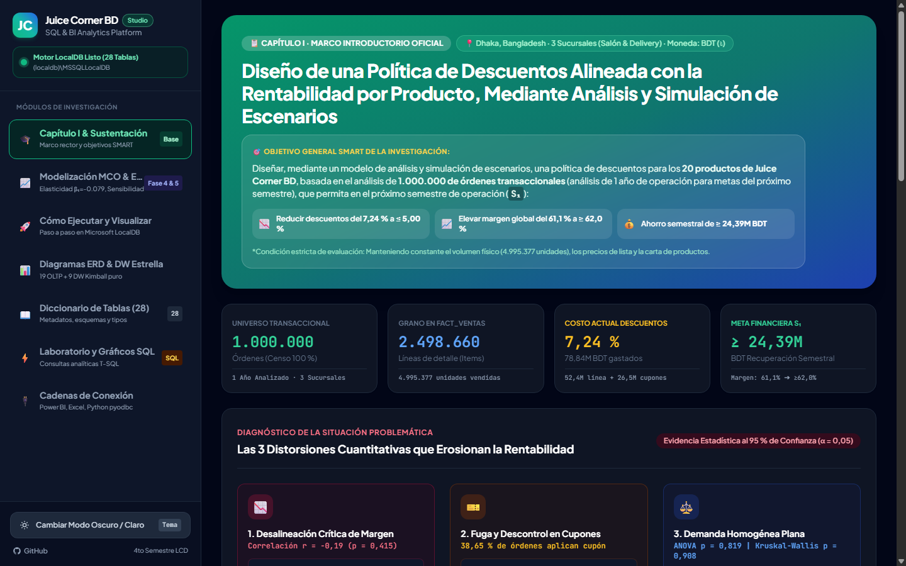
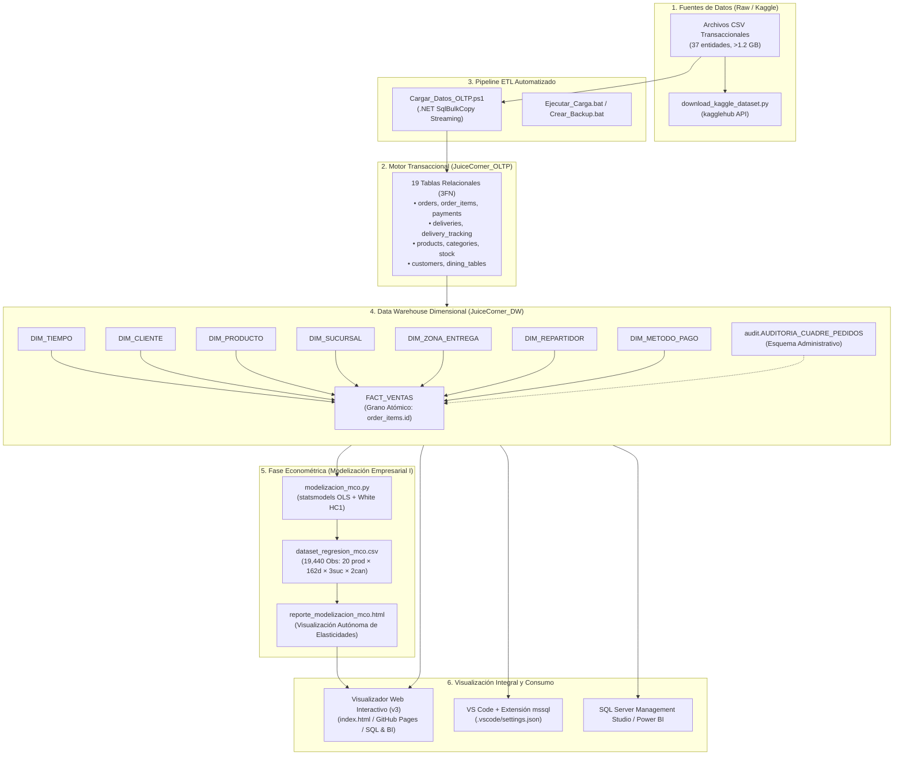

# Diseño de una Política de Descuentos Alineada con la Rentabilidad por Producto, Mediante Análisis y Simulación de Escenarios, en Juice Corner BD de la Ciudad de Dhaka, Bangladesh
### Proyecto Integrador I — Ingeniería de Sistemas / Ciencia de Datos (4to Semestre)

[](https://joseferm.github.io/JuiceCorner-DataScience/)
[](https://joseferm.github.io/JuiceCorner-DataScience/reporte_modelizacion_mco.html)
[](#paso-2-carga-masiva-de-datos-transaccionales)
[](https://github.com/JoseFerM/JuiceCorner-DataScience)
[](#11-normativas-de-gobernanza-y-calidad-aplicadas)

---

## Jerarquía Documental del Proyecto

Toda la arquitectura, ingeniería de datos, modelado analítico y código ejecutable del repositorio se subordinan formalmente a la siguiente jerarquía documental:

```text
  ┌────────────────────────────────────────────────────────────────────────┐
  │              NIVEL 1: CIMA Y BASE METODOLÓGICA RECTORA                 │
  │   Docs/00_Proyecto_Integrador/Capitulo_I_Marco_Introductorio_Limpio.md │
  │   - Título formal, árbol del problema y objetivos SMART (OE1 a OE6)    │
  │   - Sistema de hipótesis (Hi / H0) y marco metodológico cuantitativo   │
  └───────────────────────────────────┬────────────────────────────────────┘
                                      │
  ┌───────────────────────────────────┴────────────────────────────────────┐
  │          NIVEL 2: INFORME CONSOLIDADO VIGENTE (FASES 1 A 4)            │
  │   Docs/00_Proyecto_Integrador/Informe_Consolidado_Fases_1_a_4.docx     │
  │   - Documento consolidado (Caps. I–III): Fases 1, 2, 3 y 4 (MCO)       │
  │   - Evidencias numéricas, validación de hipótesis, R y modelo MCO      │
  └───────────────────────────────────┬────────────────────────────────────┘
                                      │
  ┌───────────────────────────────────┴────────────────────────────────────┐
  │       NIVEL 3: ESPECIFICACIONES TÉCNICAS Y DOCUMENTACIÓN POR MATERIA   │
  │   Docs/AVANCE_POR_MATERIAS.md (Índice maestro de bases y avance)       │
  │   Docs/01_Ingenieria_Datos_DW/ (OLTP 3FN, Decálogo Kimball DW, Auditoría)│
  │   Docs/02_Estadistica/ (Inferencia ANOVA, Kruskal-Wallis, Pearson r)   │
  │   Docs/03_Modelizacion_MCO/ (Enfoque Matricial MCO y Elasticidades)    │
  │   Docs/04_Optimizacion/ (Formulación LP PuLP - Escenario E3)           │
  │   Docs/05_Finanzas_y_Marketing/ (Costos, Márgenes y Reglas Cupones)    │
  └───────────────────────────────────┬────────────────────────────────────┘
                                      │
  ┌───────────────────────────────────┴────────────────────────────────────┐
  │          NIVEL 4: ARTEFACTOS TECNOLÓGICOS Y CÓDIGO OPERATIVO           │
  │   DDL: JuiceCorner_OLTP.sql, JuiceCorner_DW.sql                        │
  │   ETL: Cargar_Datos_OLTP.ps1, Ejecutar_Carga.bat, Crear_Backup.bat     │
  │   Visualizador: index.html (GitHub Pages) y visualizador_sql.html (v3) │
  │   Econometría: modelizacion_mco.py, reporte_modelizacion_mco.html      │
  │   Resultados: resultados_modelizacion/ (dataset 19.4k obs, coefs, E1/E2)│
  └────────────────────────────────────────────────────────────────────────┘
```

> [!IMPORTANT]
> **Documentos Oficiales Clave:**
> 1. **Cima y Marco Metodológico:** [`Docs/00_Proyecto_Integrador/Capitulo_I_Marco_Introductorio_Limpio.md`](Docs/00_Proyecto_Integrador/Capitulo_I_Marco_Introductorio_Limpio.md) (y [`Capitulo_I_Marco_Introductorio_Limpio.html`](Docs/00_Proyecto_Integrador/Capitulo_I_Marco_Introductorio_Limpio.html)) define la formulación académica, el árbol del problema, las hipótesis y los objetivos específicos OE1 a OE6.
> 2. **Informe Consolidado Vigente (Fases 1 a 4):** [`Docs/00_Proyecto_Integrador/Informe_Consolidado_Fases_1_a_4.docx`](Docs/00_Proyecto_Integrador/Informe_Consolidado_Fases_1_a_4.docx) (y [`.md`](Docs/00_Proyecto_Integrador/Informe_Consolidado_Fases_1_a_4.md) / [`.html`](Docs/00_Proyecto_Integrador/Informe_Consolidado_Fases_1_a_4.html)) es el documento consolidado vigente (Capítulos I a III) que agrupa las evidencias y resultados de las Fases 1, 2, 3 y 4 (MCO). *(Histórico anterior Fases 1–3: `Avance.docx`.)*
> 3. **Avance y Bases por Materia:** [`Docs/AVANCE_POR_MATERIAS.md`](Docs/AVANCE_POR_MATERIAS.md) centraliza el estado de avance y fundamentos teóricos por asignatura (Ingeniería de Datos, Estadística, Modelización MCO, Optimización y Finanzas/Marketing).
> 4. **Horizonte de Análisis:** Todos los análisis (OLTP, DW, R y MCO) se ejecutaron directamente sobre el dataset original de Kaggle sin modificar: **162 días de operación** (11 de enero al 21 de junio de 2026, ~5,5 meses / semestre base $S_0$), para proyectar y calibrar las metas del próximo semestre ($S_1$).

---

## 1. Visión General del Proyecto

**Juice Corner BD** es una cadena comercial gastronómica especializada en la elaboración y venta de jugos naturales, batidos y snacks, con tres sucursales operativas situadas en Dhaka, Bangladesh. La empresa comercializa un menú de 20 productos a través de dos canales principales: consumo en salón (`dine_in`) y servicio a domicilio (`delivery`), registrando sus operaciones en Taka bangladesí (BDT).

El universo analizado comprende **1.000.000 de órdenes transaccionales**, **2.498.660 líneas de detalle** y **4.995.377 unidades físicas comercializadas**, correspondientes a **162 días continuos de operación** (11 de enero al 21 de junio de 2026, ~5,5 meses / período base $S_0$) sobre el dataset original sin modificar, para establecer con solidez las metas de rentabilidad del próximo semestre ($S_1$).

### Diagnóstico de la Situación Problemática
La rentabilidad operativa de Juice Corner BD se encuentra severamente erosionada debido a una política de descuentos empírica y desalineada del margen de contribución. Actualmente destina el **7,24 % de su subtotal neto a descuentos** (78.843.704 BDT: 52,35M en descuentos directos de línea y 26,49M en cupones promocionales):
- **Desalineación Crítica:** Existe una correlación negativa ($r = -0,19; p = 0,415$) entre tasa de descuento y margen del producto. El ítem con mayor margen (*Blue Lagoon Mocktail*, 94,2 %) recibe el descuento más alto (11,1 %), mientras que el de menor margen (*Strawberry Cream Shake*, 14,4 %) no recibe beneficio alguno.
- **Cupones Ciegos y Fuga de Reglas:** El 38,65 % de las órdenes utiliza cupón, deduciéndose sobre la canasta completa sin discriminar mix y restando en promedio **68 BDT de margen por pedido**. Además, cupones como `EID50` se aplicaron fuera de vigencia en el 94,4 % de sus usos y `VIP100` bajo el monto mínimo en el 18,7 %.
- **Homogeneidad de Demanda:** Los 20 productos venden prácticamente el mismo volumen (~5 % de la mezcla cada uno, CV = 0,26 %, ANOVA $p = 0,819$). Ningún producto justifica descuentos diferenciados por rotación.
- **Consecuencia Financiera:** La empresa incurre en un sobrecosto semestral de al menos **24,39 millones de BDT** respecto a la meta corporativa del 5,00 % del subtotal neto.

---

## 2. Objetivos de la Investigación y Sistema de Hipótesis

### Objetivo General
Diseñar, mediante un modelo de análisis y simulación de escenarios, una política de descuentos para los 20 productos de Juice Corner BD que permita, en el próximo período operativo de la empresa, reducir la proporción de descuentos del **7,24 % al 5,00 % o menos** del subtotal neto y aumentar el margen de contribución global del **61,1 % al 62,0 % o más**, manteniendo constantes el volumen de unidades vendidas, los precios de lista y la composición de la carta.

### Objetivos Específicos (OE1 a OE6)
1. **OE1. Diagnosticar** la estructura histórica de descuentos (de línea y por cupones) y el margen de contribución individual de los 20 productos a partir de 1.000.000 de órdenes.
2. **OE2. Construir** un repositorio dimensional Data Warehouse (esquema estrella con 1 tabla de hechos `FACT_VENTAS` y 7 dimensiones) que garantice consolidación, gobernanza e integridad contable sin descuadres.
3. **OE3. Contrastar** estadísticamente la homogeneidad de la demanda diaria y la correlación existente entre la tasa de descuento otorgada y el margen a precio de lista ($\alpha = 0,05$).
4. **OE4. Estimar** la sensibilidad de la demanda y determinar el umbral de caída de volumen de equilibrio ante variaciones de descuento por canal, sucursal y categoría.
5. **OE5. Simular** escenarios de asignación promocional (línea base actual, reasignación moderada y optimización lineal orientada a margen) bajo volumen y carta constantes.
6. **OE6. Proponer** la política definitiva de descuentos diferenciados y la reglamentación estricta de cupones que satisfaga simultáneamente el costo de descuentos $\le 5,00 \%$ y un margen global $\ge 62,00 \%$.

### Sistema de Hipótesis
- **Hipótesis de Investigación ($H_i$):** El diseño y aplicación de una política de descuentos comerciales alineada con el margen de contribución por producto permite reducir el costo total de descuentos al 5,00 % o menos del subtotal neto y elevar el margen de contribución global al 62,00 % o más, manteniendo constantes el volumen, precios y carta comercial.
- **Hipótesis Nula ($H_0$):** Ninguna política de descuentos estructurada a partir del margen permite reducir el costo al 5,00 % o menos y elevar el margen al 62,00 % o más bajo condiciones de volumen y carta constantes.
- **Hipótesis de Demanda ($H_{0,2}$):** $\mu_1 = \mu_2 = \dots = \mu_{20}$ (ANOVA $F = 0,695, p = 0,819$; Kruskal-Wallis $p = 0,908$, no se rechaza $H_0$; la demanda es uniforme).

---

## 3. Indicadores Clave de Rendimiento (KPIs)

| KPI | Fórmula de Cálculo | Línea Base Observada ($S_0$) | Meta Propuesta ($S_1$) | Verificación Metodológica |
| :--- | :--- | :--- | :--- | :--- |
| **Costo de Descuentos** | $\frac{\text{Descuentos de línea} + \text{Descuentos por cupón}}{\text{Subtotal neto}} \times 100$ | **7,24 %** (78,84M BDT) | **$\le$ 5,00 %** ($\le$ 54,45M BDT) | Fases 4 y 5 (OE5 / OE6) |
| **Margen de Contribución Global** | $\frac{\text{Ventas netas} - \text{Costo ingredientes}}{\text{Ventas netas}} \times 100$ | **61,07 %** (pre-cupón)<br>**60,10 %** (post-cupón s/ ventas netas)<br>**58,64 %** (E1 Python s/ ingreso bruto post-línea) | **$\ge$ 62,00 %** (pre-cupón) | Fases 4 y 5 (OE5 / OE6) |
| **Alineación Descuento-Margen** | Correlación de Pearson ($r$) entre descuento y margen a lista | **$r = -0,19$** (desalineada / negativa) | **Positiva ($r > 0$)** | Fases 3 y 5 (OE3 / OE6) |
| **Ahorro Semestral Estimado** | Reducción de subsidios en productos con margen < 70 % | 0 BDT | **$\ge$ 24,39 Millones BDT** | Simulación de escenarios |

---

## 4. Estado de Avance por Fases (Fases 1 a 4 — Completadas)

### Fase 1: Identificación del Problema, Gobernanza y Modelo Relacional (OE1 - Completada)
- Delimitación espacial (3 sucursales en Dhaka), temporal (**162 días**: 11/01/2026 al 21/06/2026, ~5,5 meses) y operativa.
- Diseño e implementación del modelo relacional transaccional (3FN) con 19 tablas en SQL Server (`JuiceCorner_OLTP.sql`).
- Alineamiento con normas **ISO 8000** (claves naturales `_nk`), **ISO/IEC 25012** (calidad del producto de datos) y **DMBOK**.

### Fase 2: Construcción y Organización de Datos (Data Warehouse & ETL) (OE2 - Completada)
- **Esquema Estrella Puro:** Tabla de hechos central `FACT_VENTAS` (grano atómico por línea `order_items.id`, 2.498.660 filas) y 7 dimensiones conformadas (`DIM_TIEMPO`, `DIM_CLIENTE`, `DIM_PRODUCTO`, `DIM_SUCURSAL`, `DIM_ZONA_ENTREGA`, `DIM_REPARTIDOR`, `DIM_METODO_PAGO`).
- **Eliminación de Nulos:** Claves sustitutas comodín `sk = -1` (`Desconocido / No aplica`) para compras anónimas o pedidos en salón.
- **Fórmula de Monto Neto Auditada:**
  $$\text{monto\_neto} = \text{subtotal} - \text{descuento\_cupon\_prorr} + \text{costo\_envio\_prorr} + \text{impuesto\_prorr}$$
- **Pipeline ETL Masivo:** Carga en streaming vía PowerShell (`Cargar_Datos_OLTP.ps1` y `Ejecutar_Carga.bat`) basada en .NET `SqlBulkCopy` con validación de 0 descuadres en `audit.AUDITORIA_CUADRE_PEDIDOS`.
- **Horizonte Temporal Verificado:** Cobertura real de **162 días continuos** (11 de enero al 21 de junio de 2026, ~5,5 meses) directamente sobre el dataset original sin alterar fechas ni valores contables.

### Fase 3: Análisis Estadístico e Inferencia en R (OE3 - Completada)
- **Homogeneidad de Demanda:** ANOVA ($F = 0,70, p = 0,819$) y Kruskal-Wallis ($p = 0,908$) descartan diferencias de venta entre productos. Coeficiente $V$ de Cramér entre 0,0025 y 0,0077 demuestra que la mezcla es independiente de sucursal, canal o fecha.
- **Concentración del Desgaste Promocional:** 7 productos con margen menor al 70 % absorben **42,4 millones de BDT** (el 81 % del descuento de línea y 54 % del costo total promocional).
- **Infracción de Cupones:** 94,4 % de órdenes de `EID50` fuera de vigencia; 18,7 % de `VIP100` bajo el monto mínimo; y destrucción de 68 BDT de margen neto por orden con cupón.

### Fase 4: Modelización Econométrica MCO, Elasticidades y Sensibilidad (OE4 / OE5 - Completada)
- **Estimación Econométrica OLS con Errores Robustos White HC1:** Modelo log-lineal estimado sobre panel de 19.440 observaciones en Python (`modelizacion_mco.py`).
- **Elasticidad-Precio Confirmada ($\beta_1 = -0.0792$, $p < 0.001$):** Demanda altamente inelástica que garantiza margen de maniobra para retirar subsidios sin pérdida de clientes.
- **Canal Delivery como Motor ($\delta_1 = +0.2009$):** Aporta un +22,3 % más volumen comercial que salón presencial.
- **Análisis de Sensibilidad de Quiebre (7,70 %):** La demanda total tendría que contraerse más de un 7,70 % (384.644 unidades) para que la reasignación moderada (E2) deje de generar ahorro neto frente a la línea base E1.
- **Visualizador y Reporte Autónomo:** Integrado en [`index.html`](index.html) y [`reporte_modelizacion_mco.html`](reporte_modelizacion_mco.html).

---

## 5. Próximo Paso Estratégico: Optimización Lineal y Gobernanza (Fase 5 - OE5 y OE6 - En Curso)

### A. Dimensión de Marketing y Blindaje de Canasta (OE6)
- **Blindaje y Gobernanza de Cupones:** Bloqueo automático de redenciones fuera de vigencia y aplicación estricta de cupos por cliente.
- **Condicionamiento Selectivo de Canasta:** Restricción de cupones para excluir productos de margen vulnerable (< 50 %) y focalizarlos en líneas altamente rentables (> 70 %).
- **Umbrales Mínimos Dinámicos:** Configuración de montos mínimos de compra que garanticen rentabilidad incremental real.
- **Transición a Descuentos Estacionales:** Supresión de descuentos de línea estáticos en productos de bajo margen.

### B. Dimensión Financiera y Programación Lineal (Fase 5 - OE5 / OE6)
- **Estructura Integral de Costos Operativos (COGS y Logística):** Modelado de empaque, mano de obra y comisiones de delivery.
- **Modelo de Optimización Lineal LP (PuLP):** Maximización de la función objetivo de margen de contribución sujeta a costo de descuentos $\le 5,00\%$ y margen global $\ge 62,00\%$ (Escenario E3).
- **Matriz Definitiva de Asignación Promocional:** Reglas automatizadas por ítem y canal para implementación en producción.

---

## 6. Visualizador Web Interactivo y SQL Studio (v3)

El proyecto incluye un entorno de exploración analítica disponible en la nube y de forma local:



```text
┌───────────────────────┬────────────────────────────────────────────────────────┐
│  JUICE CORNER STUDIO  │  PANEL INTERACTIVO CENTRAL (HTML5 + Tailwind + Chart)  │
│  (Navegación Vertical)│                                                        │
│                       │                                                        │
│  🏛️ Capítulo I        │  - Cima metodológica, objetivos SMART y KPIs base      │
│  📈 Modelización MCO  │  - Regresión OLS, elasticidades, simulador y gráficos  │
│  🚀 Cómo Ejecutar     │  - Guía paso a paso LocalDB, SSMS y backup .BAK        │
│  📐 Diagramas ERD     │  - Esquema Relacional 3FN (19T) y Kimball DW (9T)      │
│  📖 Diccionario (28)  │  - Metadatos campo a campo (ISO 8000 / DMBOK)          │
│  🧪 Laboratorio SQL   │  - Playground interactivo con consultas y gráficos     │
│  🔌 Cadenas Conexión  │  - Snippets listos para Python, Power BI y Excel       │
└───────────────────────┴────────────────────────────────────────────────────────┘
```

### Funcionalidades de la Plataforma:
- **Modelización Econométrica MCO (Fase 4 & 5):** Módulo interactivo con estimación de demanda log-lineal, elasticidad-precio (β₁ = -0.0792), simulación de 3 escenarios (E1, E2 y E3 LP), matriz de dispersión de 20 productos, análisis de sensibilidad (umbral 7.70%) y gráficos Chart.js.
- **Diccionario de Tablas Completo (28 Tablas):** Especificación campo a campo de las 19 tablas del OLTP y las 9 tablas del Data Warehouse.
- **Laboratorio y Gráficos SQL:** Consultas analíticas predefinidas para validar ventas por mes, ranking de productos y cuadres contables.
- **Cadenas de Conexión:** Snippets listos para conectar Excel, Power BI, Python (pyodbc, SQLAlchemy) y Node.js.
- **Acceso Local:** Ejecutable haciendo doble clic en [`visualizador_sql.html`](visualizador_sql.html) o [`index.html`](index.html), o mediante la opción `[7]` del menú [`ejecutar_sql.bat`](ejecutar_sql.bat).
- **Despliegue en la Nube (GitHub Pages):**
  * **Visualizador Web Principal (Menú Lateral Vertical):** [https://joseferm.github.io/JuiceCorner-DataScience/](https://joseferm.github.io/JuiceCorner-DataScience/)
  * **Reporte Autónomo de Modelización MCO:** [https://joseferm.github.io/JuiceCorner-DataScience/reporte_modelizacion_mco.html](https://joseferm.github.io/JuiceCorner-DataScience/reporte_modelizacion_mco.html)

---

## 7. Arquitectura Global del Sistema



---

## 8. Fase Econométrica: Modelización MCO, Elasticidades y Simulación de Escenarios

Como parte de **Modelización Empresarial I (4to Semestre LCD)**, se construyó un modelo econométrico log-lineal estimado por **Mínimos Cuadrados Ordinarios (MCO)** con corrección de heterocedasticidad mediante errores estándar robustos **White (HC1)**. El modelo cuantifica la elasticidad-precio de la demanda y evalúa el impacto marginal de los descuentos y canales comerciales.

### Ecuación Econométrica Log-Lineal
$$\ln(Q_{it}) = \beta_0 + \beta_1 \ln(P_{it}) + \beta_2 D_{it} + \beta_3 Desc_{it} + \delta_1 Delivery_{it} + \sum_{k=2}^3 \gamma_k Sucursal_{kt} + u_{it}$$

Donde:
- $\ln(Q_{it})$: Logaritmo natural de las unidades físicas demandadas del producto $i$ en el día $t$.
- $\ln(P_{it})$: Logaritmo natural del precio unitario de lista. $\beta_1$ representa la **elasticidad-precio de la demanda**.
- $D_{it}$: Tasa de descuento de línea otorgada a nivel de ítem (0% a 15%).
- $Desc_{it}$: Intensidad porcentual de cupones promocionales de orden prorrateados.
- $Delivery_{it}$: Variable dummy (1 = Delivery a domicilio, 0 = Salón presencial `dine_in`).
- $Sucursal_{kt}$: Dummies territoriales para Banani y Gulshan (referencia: Dhanmondi).

### Resultados de la Estimación MCO (statsmodels OLS)
- **Observaciones del Panel Balanceado:** 19.440 (20 productos × 162 días de operación × 3 sucursales × 2 canales).
- **Bondad de Ajuste:** $R^2 = 0.369$ ($R^2_{adj} = 0.369$), Estadístico $F = 1,896$ ($p < 0.001$).
- **Elasticidad-Precio ($\beta_1 = -0.0792$, $p < 0.001$):** Demanda **altamente inelástica** ($|\beta_1| = 0.0792 \ll 1$). Un aumento del 1% en el precio reduce el volumen en apenas 0.08%. Esto garantiza que **la empresa puede recortar descuentos sin temor a perder clientes ni volumen de ventas**.
- **Ineficacia del Descuento de Línea ($\beta_2 = +0.0006$, $p = 0.006$ HC1):** Subir 1 punto porcentual de descuento solo genera un insignificante +0.06% en volumen. Los descuentos de línea subsidian compras sin respuesta volumétrica.
- **Efecto Negativo de Cupones ($\beta_3 = -0.0113$, $p < 0.001$):** Cada punto de cupón tiene un impacto neto negativo (-1.13%), canibalizando 68 BDT de margen por pedido sin expandir el mercado.
- **Motor Comercial Delivery ($\delta_1 = +0.2009$, $p < 0.001$):** El canal delivery genera un **+22.3% más volumen** que el salón presencial ($e^{0.2009} - 1$). Si se mantienen incentivos, deben focalizarse aquí.
- **Homogeneidad Territorial ($\gamma_1 = -0.0028, p = 0.227; \gamma_2 = -0.0023, p = 0.323$):** Las 3 sucursales se comportan de manera idéntica; no se justifica discriminación de precios por local.

### Diagnósticos de Supuestos Clásicos
1. **Normalidad (Jarque-Bera, $p = 0.000$):** Por el Teorema del Límite Central (TLC) con $N = 19.440$, los estimadores son asintóticamente normales e insesgados.
2. **Homocedasticidad (Breusch-Pagan, $p = 0.014$):** Se detectó heterocedasticidad leve, corregida exhaustivamente con matriz de covarianzas robusta **White HC1**.
3. **Multicolinealidad (VIF Máximo = 2.73):** Todos los factores VIF están muy por debajo de 5, confirmando ortogonalidad entre regresores.

### Simulación de Escenarios y Análisis de Sensibilidad
| Escenario | Costo Descuentos (% Subtotal) | Margen Contribución Global (%) | Total Descuentos (BDT) | Margen Semestral (BDT) | Ahorro vs E1 (BDT) |
| :--- | :---: | :---: | :---: | :---: | :---: |
| **E1 — Línea Base Actual (S₀)** | **7.24%** | **58.64%** | 78.843.704 | 638.568.440 | 0 BDT (Ref.) |
| **E2 — Reasignación Moderada** | **2.26%** *(2.24% s/ lista)* | **61.25%** *(62.47% pre-cupón)* | 25.538.812 | 691.873.332 | **+53.304.892 BDT** |
| **E3 — Meta Optimizada LP (Fase 5)** | **≤ 5.00%** | **≥ 62.00%** | ≤ 54.450.000 | > 700.000.000 | **Resolución con PuLP** |

> [!TIP]
> **Umbral de Quiebre de Equilibrio (7.70%):** En el análisis de sensibilidad, la demanda total tendría que contraerse más de un **7.70%** (pérdida de 384.644 unidades) para que el Escenario E2 deje de ser superior a la línea base E1. Dado que la elasticidad-precio estimada es $\beta_1 = -0.0792$, la caída real esperada es menor a **0.5%**, asegurando la viabilidad comercial y financiera de la reasignación.

### Artefactos de la Fase de Modelización
- Script ejecutable en Python: [`modelizacion_mco.py`](modelizacion_mco.py)
- Reporte ejecutivo interactivo HTML: [`reporte_modelizacion_mco.html`](reporte_modelizacion_mco.html) (disponible en línea en [GitHub Pages](https://joseferm.github.io/JuiceCorner-DataScience/reporte_modelizacion_mco.html))
- Datos panel y matrices de regresión: [`resultados_modelizacion/`](resultados_modelizacion/)

---

## 9. Estructura del Repositorio

```text
JuiceCorner-DataScience/
├── .vscode/
│   └── settings.json                                 # Perfil de conexión LocalDB para extensión mssql
├── dataset/                                          # Documentación del origen de datos
│   └── README.md                                     # Guía del dataset y política de exclusión
├── Docs/                                             # Documentación organizada por materias principales
│   ├── AVANCE_POR_MATERIAS.md                        # Índice maestro: bases teóricas y avance por asignatura
│   ├── 00_Proyecto_Integrador/                       # Capítulo I, Avance.docx, Avance adaptado y ajuste temporal
│   ├── 01_Ingenieria_Datos_DW/                       # Justificación OLTP 3FN, Decálogo Kimball DW y auditoría
│   ├── 02_Estadistica/                               # Bases y avance de inferencia (ANOVA, Kruskal-Wallis, Pearson)
│   ├── 03_Modelizacion_MCO/                          # Guía matricial MCO, Documentos A/B, bases y avance
│   ├── 04_Optimizacion/                              # Bases y formulación LP (PuLP - Escenario E3)
│   ├── 05_Finanzas_y_Marketing/                      # Bases financieras, costos operativos y gobernanza de cupones
│   ├── img/                                          # Figuras técnicas de soporte (figuras 1 a 6)
│   └── visualizador_studio_preview.png               # Captura de pantalla de la plataforma SQL & BI Studio
├── .gitignore                                        # Exclusión de CSVs masivos (>100MB), node_modules y temporales
├── Cargar_Datos_OLTP.ps1                             # Pipeline ETL automatizado (.NET SqlBulkCopy streaming)
├── download_kaggle_dataset.py                        # Descarga oficial del dataset vía API kagglehub
├── Ejecutar_Carga.bat                                # Lanzador batch para la carga masiva ETL
├── Crear_Backup.bat                                  # Generador y validador de copia de seguridad .BAK
├── ejecutar_sql.bat                                  # Menú interactivo CLI para inicialización y pruebas
├── index.html                                        # Visualizador interactivo web (GitHub Pages)
├── visualizador_sql.html                             # Visualizador interactivo web v3 (copia local de estudio)
├── modelizacion_mco.py                               # Script de estimación econométrica MCO y robustez HC1 (Python)
├── reporte_modelizacion_mco.html                     # Reporte ejecutivo y analítico de la modelización MCO
├── resultados_modelizacion/                          # Salidas de econometría (dataset 19.4k obs, coefs, E1/E2)
├── JuiceCorner_DW.sql                                # DDL del Data Warehouse dimensional (Modelo Estrella)
├── JuiceCorner_OLTP.sql                              # DDL de la base de datos transaccional (19 tablas 3FN)
└── README.md                                         # Portal de documentación centralizada del proyecto
```

---

## 10. Guía de Puesta en Marcha (Local)

### Requisitos Previos
- Microsoft SQL Server (LocalDB `(localdb)\MSSQLLocalDB`, SQLEXPRESS o instancia completa).
- Utilidad de línea de comandos `sqlcmd`.
- PowerShell 5.1 o superior.

### Paso 1: Inicialización con el Menú Interactivo
Ejecuta el archivo [`ejecutar_sql.bat`](ejecutar_sql.bat):
```cmd
.\ejecutar_sql.bat
```
El menú automatiza:
- Arranque del servicio LocalDB.
- Creación de la base de datos transaccional `JuiceCorner_OLTP`.
- Creación del Data Warehouse dimensional `JuiceCorner_DW`.
- Comprobación del estado de las 28 tablas.
- Apertura del Visualizador Web Interactivo (Opción 7).

### Paso 2: Carga Masiva de Datos Transaccionales
Para cargar el dataset a SQL Server:
```cmd
.\Ejecutar_Carga.bat
```

### Paso 3: Generación de Copia de Seguridad (.BAK)
Para crear un respaldo completo y validado de la base transaccional:
```cmd
.\Crear_Backup.bat
```

---

## 11. Normativas de Gobernanza y Calidad Aplicadas

- **ISO/IEC 25012:** Garantía de exactitud sintáctica, completitud, consistencia matemática de importes netos y trazabilidad temporal.
- **ISO 8000:** Calidad de datos maestros en clientes, productos y sucursales con identificadores naturales (`nk`) y sustitutos (`sk`).
- **DMBOK (Data Management Body of Knowledge):** Separación explícita de modelos operacionales (3FN) y analíticos (Kimball), gestión de metadatos mediante diccionario vivo y reglas de prorrateo documentadas.

---

## 12. Equipo y Créditos

- **Proyecto:** Proyecto Integrador I — 4to Semestre
- **Institución:** Licenciatura en Ciencia de Datos / Ingeniería de Sistemas — Universidad Privada del Valle
- **Caso Empresarial:** Juice Corner BD — Dhaka, Bangladesh
