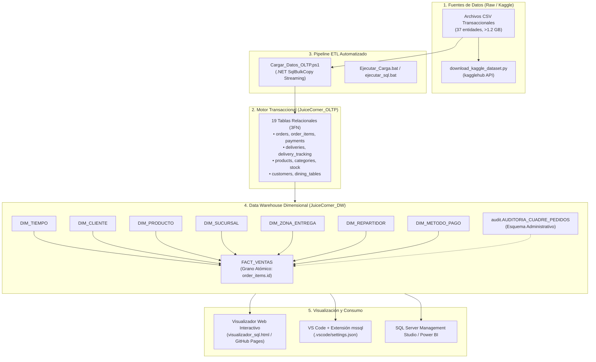

# Juice Corner BD — Proyecto Integrador I
### Alineación de la Política de Descuentos con la Rentabilidad por Producto

[](https://www.microsoft.com/sql-server)
[](#paso-2-carga-masiva-de-datos-transaccionales)
[](https://joseferm.github.io/JuiceCorner-DataScience/)
[](https://github.com/JoseFerM/JuiceCorner-DataScience)
[](#9-normativas-de-gobernanza-y-calidad-aplicadas)

---

> [!IMPORTANT]
> **Documento Oficial de Entrega:**
> El informe formal, completo y definitivo a presentar para este proyecto integrador es **[`Docs/Avance.docx`](Docs/Avance.docx)** (*Alineación de la política de descuentos con la rentabilidad por producto en Juice Corner BD*). En él se detallan los objetivos SMART, el decálogo del Data Warehouse, la justificación del modelo y las pruebas estadísticas en R con sus respectivas tablas y figuras metodológicas.

---

## 1. Visión General del Proyecto

**Juice Corner BD** es una cadena de jugos, batidos y snacks con tres sucursales en Dhaka, Bangladesh, que vende 20 productos tanto en local (`dine_in`) como por entrega a domicilio (`delivery`), operando en Taka bangladesí (BDT). 

El proyecto analiza **1.000.000 de órdenes transaccionales**, **2.498.660 líneas de detalle** y **4.995.377 unidades vendidas** a lo largo de 160 días completos de operación.

### Diagnóstico del Problema Empresarial
La empresa gasta el **7,24 % de su subtotal neto en descuentos** (78,8 millones de BDT: 52,4 millones en descuentos de línea y 26,5 millones en cupones). Estos descuentos no guardan relación con la rentabilidad de cada producto:
- **Descuentos de línea ciegos:** Afectan a 9 de los 20 productos con tasas de entre 6,7 % y 11,1 %. El producto de mayor margen (*Blue Lagoon Mocktail*, 94,2 %) recibe el descuento más alto (11,1 %), mientras que el de menor margen (*Strawberry Cream Shake*, 14,4 %) no recibe descuento alguno.
- **Cupones globales no segmentados:** El 38,65 % de las órdenes utiliza cupón promocional aplicado sobre la canasta completa sin discriminar el margen de los artículos que contiene.
- **Demanda plana no explicativa:** Cada uno de los 20 productos vende prácticamente el mismo volumen (entre 248.416 y 250.952 unidades, ~5 % de la mezcla, CV = 0,26 %). Por tanto, la disparidad de descuentos no se justifica por variaciones de demanda ni de rotación.

### Objetivo General del Proyecto
Diseñar una política de descuentos para los 20 productos de Juice Corner BD que, evaluada sobre las 1.000.000 de órdenes analizadas y manteniendo el mismo volumen de unidades, reduzca el costo de descuentos de **7,24 % a 5,00 % o menos** del subtotal neto y eleve el margen de contribución global de **61,1 % a 62,0 % o más**, sin modificar los precios de lista ni la carta.

---

## 2. Indicadores Clave de Rendimiento (KPIs)

| KPI | Fórmula de Cálculo | Línea Base (Datos Reales) | Meta del Proyecto | Verificación |
| :--- | :--- | :--- | :--- | :--- |
| **Costo de Descuentos** | $\frac{\text{Descuentos de línea} + \text{Descuentos por cupón}}{\text{Subtotal neto}} \times 100$ | **7,24 %** (78,8M BDT) | **$\le$ 5,00 %** | Fases 4 y 5 |
| **Margen de Contribución Global** | $\frac{\text{Ventas netas} - \text{Costo ingredientes}}{\text{Ventas netas}} \times 100$ | **61,07 %** (antes de cupón)<br>**60,10 %** (después de cupón) | **$\ge$ 62,00 %** | Fases 4 y 5 |
| **Alineación Descuento-Margen** | Correlación de Pearson ($r$) entre tasa de descuento y margen a lista | **$r = -0,19$** (desalineada / negativa) | **Positiva ($r > 0$)** | Fases 3 y 5 |

---

## 3. Estado de Avance por Fases (Fases 1 a 3)

### Fase 1: Identificación del Problema y Objetivos SMART (Completada)
- Formulación de la pregunta de investigación y delimitación del alcance comercial en Dhaka, Bangladesh.
- Definición de criterios SMART y requerimientos de información sobre las tablas de ventas, costos de ingredientes y cupones.
- Identificación de datos faltantes para modelado (comportamiento de demanda ante cambios de precio) a resolver mediante el cálculo de caída de volumen de equilibrio en la Fase 5.

### Fase 2: Construcción y Organización de Datos (Data Warehouse & ETL) (Completada)
- **Modelo Estrella Puro:** Implementación física en SQL Server (`JuiceCorner_DW.sql`) con una única tabla de hechos central `FACT_VENTAS` (grano atómico por línea `order_items.id`, 2.498.660 filas) y 7 dimensiones conformadas (`DIM_TIEMPO`, `DIM_CLIENTE`, `DIM_PRODUCTO`, `DIM_SUCURSAL`, `DIM_ZONA_ENTREGA`, `DIM_REPARTIDOR`, `DIM_METODO_PAGO`).
- **Eliminación de Nulos:** Claves artificiales comodín `sk = -1` (`Desconocido / No aplica`) para asegurar integridad foránea obligatoria en clientes anónimos y consumos en salón.
- **Fórmula Matemática Corregida de Monto Neto:**
  $$\text{monto\_neto} = \text{subtotal} - \text{descuento\_cupon\_prorr} + \text{costo\_envio\_prorr} + \text{impuesto\_prorr}$$
  *El subtotal del TPS ya viene neto de descuentos de línea, eliminando el riesgo de doble descuento.*
- **Pipeline ETL Masivo:** Carga por lotes streaming en PowerShell (`Cargar_Datos_OLTP.ps1` y `Ejecutar_Carga.bat`) basada en .NET `SqlBulkCopy` y control de cuadre contable en `audit.AUDITORIA_CUADRE_PEDIDOS` (subtotal verificado en 1.089.008.540 BDT y facturación en 1.147.618.023,60 BDT).

### Fase 3: Análisis Estadístico y Modelización en R (En curso / Foco Actual)
- **Pruebas de Hipótesis de Demanda:**
  - ANOVA ($F = 0,70, p = 0,819$) y Kruskal-Wallis ($H = 11,45, p = 0,908$) confirman que no hay diferencias significativas de venta diaria entre productos.
  - Chi-cuadrado de independencia con $V$ de Cramér entre 0,0025 y 0,0077 demuestra que la mezcla de ventas no varía por sucursal, canal, mes ni cupón. Una única política de descuentos es válida para todas las sucursales.
- **Desalineación Estadística del Descuento:**
  - Correlación de Pearson $r = -0,19$ ($p = 0,415$) y Spearman $\rho = -0,21$.
  - Los 7 productos con margen menor a 70 % concentran **42,4 millones de BDT** en descuentos (**81 % del descuento de línea** y **54 % del costo total de descuentos**). Retirar estos subsidios representa la principal palanca de optimización.
- **Fuga y Descontrol en Cupones:**
  - Cupones aplicados fuera de sus reglas: `EID50` se usó fuera de vigencia en el **94,4 %** de sus pedidos; `VIP100` bajo el monto mínimo en el **18,7 %**; y todos superaron con creces el límite de usos configurado.
  - Cada orden con cupón resta en promedio **68 BDT de margen** (contribución de 615 BDT con cupón vs. 653 BDT sin cupón, con un tamaño de efecto insignificante en ticket $d = 0,09$).

---

## 4. Plan de Expansión Estratégica (Marketing y Financiera)

### A. Dimensión de Marketing (Fase 4)
- **Cumplimiento Forzoso de Reglas de Cupones:** Bloquear cupones fuera de vigencia y hacer respetar topes de redención por cliente.
- **Condicionamiento de Cupones por Producto:** Restringir la aplicación de cupones para excluir productos de bajo margen (< 50 %) y concentrarlos en líneas de alto margen (> 70 %).
- **Umbrales Mínimos Blindados:** Exigir montos mínimos reales que garanticen que el pedido genere margen incremental.
- **Transición de Descuentos Fijos a Campañas Estacionales:** Desactivar el descuento de línea estático en productos con margen menor a 70 %.

### B. Dimensión Financiera (Fases 4 y 5)
- **Estructura Integral de Costos Operativos (Fase 4):** Modelar el impacto de costos no contemplados en la receta (empaque, mano de obra y comisiones de delivery estimadas como porcentaje sobre precio de lista).
- **Modelo de Optimización Matemática (Fase 5):** Formulación de un modelo de programación lineal para maximizar el margen de contribución global sujeto a:
  $$\text{Costo de Descuentos} \le 5,00 \% \text{ del subtotal neto}$$
  $$\text{Margen de Contribución Global} \ge 62,00 \%$$
- **Cálculo de Caída de Volumen de Equilibrio:** Determinación analítica de la caída máxima de ventas que el negocio puede tolerar al retirar un descuento sin reducir el beneficio neto en BDT.

---

## 5. Visualizador Web Interactivo y SQL Studio (v3)

El proyecto cuenta con una plataforma interactiva completa disponible tanto de forma local como en la nube:


```text
+------------------------------------------------------------------------+
|  JUICE CORNER BD — Studio Interactivo de Arquitectura y Datos (v3)     |
+------------------------------------------------------------------------+
|  [Cómo Ejecutar]   [Diagramas ERD]   [Diccionario]   [Playground SQL]  |
+------------------------------------------------------------------------+
```

### Funcionalidades de la Plataforma:
- **Diccionario de Tablas Completo (28 Tablas):** Especificación campo a campo de las 19 tablas transaccionales del OLTP y las 9 tablas analíticas del Data Warehouse.
- **Laboratorio y Gráficos SQL:** Consultas analíticas predefinidas para validar ventas por mes, ranking de productos y cuadres contables.
- **Cadenas de Conexión:** Snippets listos para conectar Excel, Power BI, Python (pyodbc, SQLAlchemy) y Node.js.
- **Acceso Local:** Ejecutable haciendo doble clic en [`visualizador_sql.html`](visualizador_sql.html) o [`index.html`](index.html), o mediante la opción `[7]` del menú [`ejecutar_sql.bat`](ejecutar_sql.bat).
- **Despliegue en la Nube (GitHub Pages):** Disponible públicamente en:
  **[https://joseferm.github.io/JuiceCorner-DataScience/](https://joseferm.github.io/JuiceCorner-DataScience/)**

---

## 6. Arquitectura Global del Sistema



---

## 7. Estructura del Repositorio

```text
JuiceCorner-DataScience/
├── .vscode/
│   └── settings.json                                 # Perfil de conexión LocalDB para extensión mssql
├── dataset/                                          # Documentación del origen de datos
│   └── README.md                                     # Guía del dataset y política de exclusión
├── Docs/                                             # Documentación técnica, justificaciones y entregables
│   ├── Avance.docx                                   # INFORME FINAL OFICIAL Y DEFINITIVO A PRESENTAR
│   ├── Decalogo_Data_Warehouse_Restaurante_Corregido.md # Decálogo Dimensional V2.0 oficial
│   ├── Informe_Cambios_Data_Warehouse.md               # Informe técnico de auditoría Kimball
│   ├── informe_justificacion_oltp.md                   # Justificación técnica del modelo OLTP
│   └── visualizador_studio_preview.png               # Captura de pantalla del SQL & BI Studio
├── .gitignore                                        # Exclusión de CSVs masivos (>100MB) y temporales
├── Cargar_Datos_OLTP.ps1                             # Pipeline ETL automatizado (.NET SqlBulkCopy streaming)
├── download_kaggle_dataset.py                        # Descarga oficial del dataset vía API kagglehub
├── Ejecutar_Carga.bat                                # Lanzador batch para la carga masiva ETL
├── ejecutar_sql.bat                                  # Menú interactivo CLI para inicialización y pruebas
├── index.html                                        # Visualizador interactivo web (GitHub Pages)
├── visualizador_sql.html                             # Visualizador interactivo web v3 (copia local de estudio)
├── JuiceCorner_DW.sql                                # DDL del Data Warehouse dimensional (Modelo Estrella)
├── JuiceCorner_OLTP.sql                              # DDL de la base de datos transaccional (19 tablas 3FN)
└── README.md                                         # Portal de documentación centralizada del proyecto
```

---

## 8. Guía de Puesta en Marcha (Local)

### Requisitos Previos
- Microsoft SQL Server (LocalDB `(localdb)\MSSQLLocalDB`, SQLEXPRESS o instancia completa).
- Utilidad de línea de comandos `sqlcmd`.
- PowerShell 5.1 o superior.

### Paso 1: Inicialización con el Menú Interactivo
Ejecuta el archivo [`ejecutar_sql.bat`](ejecutar_sql.bat):
```cmd
.\ejecutar_sql.bat
```
El menú automatiza:
- Arranque del servicio LocalDB.
- Creación de la base de datos transaccional `JuiceCorner_OLTP`.
- Creación del Data Warehouse dimensional `JuiceCorner_DW`.
- Comprobación del estado de las 28 tablas.
- Apertura del Visualizador Web Interactivo (Opción 7).

### Paso 2: Carga Masiva de Datos Transaccionales
Para cargar el dataset masivo a SQL Server:
```cmd
.\Ejecutar_Carga.bat
```

---

## 9. Normativas de Gobernanza y Calidad Aplicadas

- **ISO/IEC 25012:** Garantía de exactitud sintáctica, completitud, consistencia matemática de importes netos y trazabilidad temporal.
- **ISO 8000:** Calidad de datos maestros en clientes, productos y sucursales con identificadores naturales (`nk`) y sustitutos (`sk`).
- **DMBOK (Data Management Body of Knowledge):** Separación explícita de modelos operacionales (3FN) y analíticos (Kimball), gestión de metadatos mediante diccionario vivo y reglas de prorrateo documentadas.

---

## 10. Equipo y Créditos

- **Proyecto:** Proyecto Integrador I — 4to Semestre
- **Institución:** Licenciatura en Ciencia de Datos / Ingeniería de Datos
- **Caso Empresarial:** Juice Corner BD — Dhaka, Bangladesh
